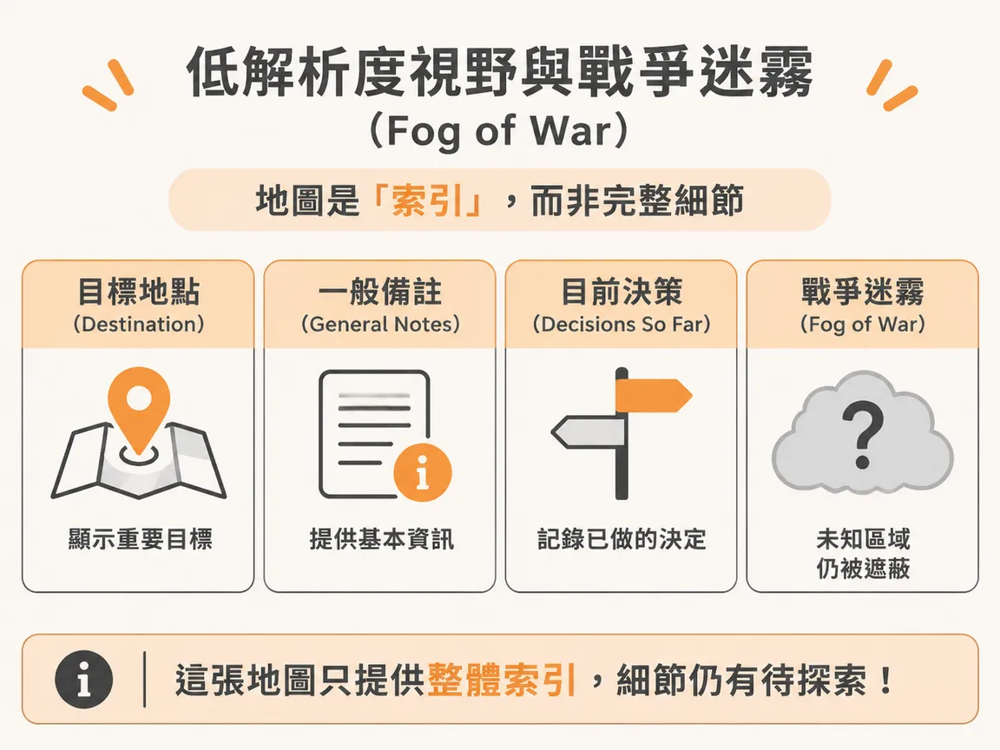

# 用 Wayfinder 繪製地圖：設定 Destination 與撥開 Fog of War

當一個模糊的想法剛浮現，規模大到無法在單一次 agent session 搞定，四周又全被迷霧包圍時，你該如何著手？在面對這種龐大且未定型的工作時，Wayfinder 提供了一套系統化的探路方式。

你可以透過重設分支並執行指令，將 Wayfinder skill 加入到 agent 的 skills 設定檔中：

<!-- derived -->
```bash
npm run reset add Wayfinder skill
```

Wayfinder 的核心由兩種資料結構組成：一張「地圖（Map）」以及掛在地圖底下的「決策工單（Decision tickets）」。在日常開發的工具裡，它們各自對應到 issue tracker 上的項目。例如在 GitHub 上，地圖本身是一張被標記為 `wayfinder:map` 的 GitHub issue，而每個決策工單則是附屬於這張地圖底下的 child issue（或者在尚未啟用 sub-issue 功能時，以 task list 關聯並在內文註記所屬地圖）。

## 繪製地圖的第一步：定義 Destination

在第一場規劃 session 裡，最優先要決定的事情就是你的目的地（Destination）。


從起點出發時，通往目的地的路徑往往還不可見，而「探路（Wayfinding）」的目的正是把這條路找出來。目的地會隨著每次任務的不同而改變；給予它一個明確的名稱，是繪製地圖的第一個動作，而且這個名稱會直接塑造後續開出來的每一張工單。只有先把目的地定下來，你才能開始推敲該如何走過去。

Wayfinder 也能用在寫程式之外的工作。例如規劃一門新課程時，可以直接開一張 Wayfinder 地圖，將目的地設為「完成整門課程」。

但在一般的程式開發工作中，建議將目的地定為「一份規格（Spec）」。也就是說，團隊先透過這張地圖，把所有可能需要放進規格書裡的決策全部討論清楚，產出一份極為詳盡的 spec，接著再交給後續的 agent 按照這份規格去實作。

過去在處理邊界非常清晰、範圍收斂得很好的工作時，我們習慣使用 GrilledWithDocs 作為寫 spec 前的釐清流程。但碰上龐大專案與巨量未知時，GrilledWithDocs 就顯得不夠用；這時 Wayfinder 就是更合適的工具，它能先幫大專案梳理出完整的架構與規格，再讓產出的 spec 進入平時熟悉的開發循環。

## 低解析度視野與戰爭迷霧（Fog of War）

整張地圖呈現的是一種「低解析度視野（low resolution view）」，它主要包含四個要素：



1. **目的地（Destination）**
2. **一般備忘筆記（General notes）**
3. **目前已做出的所有決策（Decisions made so far）**
4. **與這些決策相關的戰爭迷霧（Fog of war）**

「戰爭迷霧」是面對大型專案時非常貼切的比喻。如果你一開始就知道通往目的地的完整路徑、清楚所有該做的事情與該下的決定，工作早就輕鬆許多。但現實是，你站在起點時，永遠只能看清眼前接下來的一兩步決策，根本不可能一眼看透整個棋局。


迷霧之中那些未知的路，正是需要逐一探索的問題。隨著你在地圖上一張接著一張解決決策工單、關閉那些 issue，地圖原本籠罩在迷霧中的區塊就會被逐步揭開，進而浮現出下一步的走向。

當所有決策工單都探討完畢、全數關閉時，就代表所有該做的決策都已經塵埃落定，整張地圖的路徑正式開通。你已經順利抵達目的地——取得一份結構嚴謹、可以直接發包實作的完整規格。
