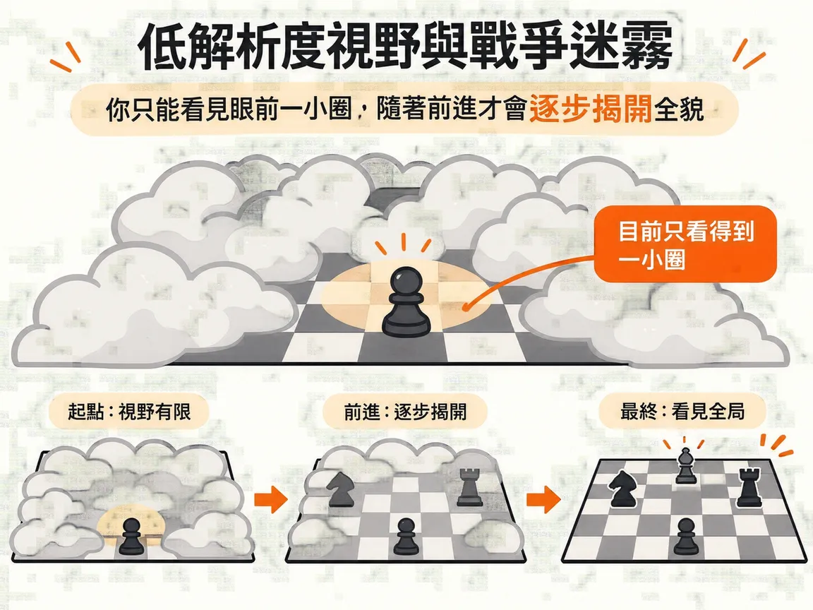

# 用 Wayfinder 繪製地圖：設定 Destination 與撥開 Fog of War

想法剛浮現時往往很模糊，規模也大到無法在單一次 agent session 搞定，四周滿是未知。面對這種龐大且未定型的工作，Wayfinder 能提供一套系統化的探路方式。

重設分支並執行指令，就能把 Wayfinder skill 加入 agent 的 skills 設定檔中：

<!-- derived -->
```bash
npm run reset add Wayfinder skill
```

Wayfinder 的核心由兩種資料結構組成：一張「地圖（Map）」與掛在地圖底下的「決策工單（Decision tickets）」。這兩者對應到 issue tracker 上的項目。以 GitHub 為例，地圖本身是一張標記為 `wayfinder:map` 的 GitHub issue。每個決策工單則是附屬於這張地圖底下的 child issue。如果尚未啟用 sub-issue 功能，可以用 task list 關聯，並在內文註記所屬地圖。

## 繪製地圖的第一步：定義 Destination

在第一場規劃 session 裡，最優先要決定的事情就是你的目的地（Destination）。


從起點出發時，通往目的地的路徑通常還看不見。「探路（Wayfinding）」的目的正是把路找出來。目的地會隨任務而改變。給予明確名稱是繪製地圖的第一步。這個名稱會直接決定後續開出的每張工單。定下目的地之後，才能開始推敲該如何走過去。

Wayfinder 也能用於寫程式以外的事務。規劃新課程時，可以直接建立一張 Wayfinder 地圖，將目的地設為「完成整門課程」。

在一般的程式開發中，建議將目的地設為「一份規格（Spec）」。先透過地圖把規格書需要的決策全數討論清楚，產出極為詳盡的 spec。後續的 agent 就能依據這份規格接手實作。

如果工作邊界清晰、範圍收斂，適合在寫 spec 前使用 GrilledWithDocs 釐清流程。但碰上龐大專案與大量未知時，GrilledWithDocs 就不足以應付。這時 Wayfinder 能先為專案梳理出完整架構與規格。產出的 spec 就能接著進入平常熟悉的開發流程。

## 低解析度視野與戰爭迷霧（Fog of War）

整張地圖呈現的是一種「低解析度視野（low resolution view）」，包含四個要素：


1. **目的地（Destination）**
2. **一般備忘筆記（General notes）**
3. **目前已做出的所有決策（Decisions made so far）**
4. **與這些決策相關的戰爭迷霧（Fog of war）**

「戰爭迷霧」很適合用來比喻大型專案。如果一開始就清楚通往目的地的完整路徑，也知道所有該做的決定，工作就會簡單許多。但現實中，你站在起點時，永遠只能看清眼前接下來的一兩步決策，根本不可能一眼看清全局。



迷霧之中的未知路徑，就是需要逐一探索的問題。在地圖上逐一解決決策工單並關閉 issue，原本被迷霧籠罩的區塊就會逐步揭開，下一步該往哪走也會跟著浮現。

當所有決策工單都探討完畢且全數關閉，代表所有該做的決策都已塵埃落定。整張地圖的路徑正式開通。此時就已順利抵達目的地，取得一份結構嚴謹、可以直接發包實作的完整規格。
