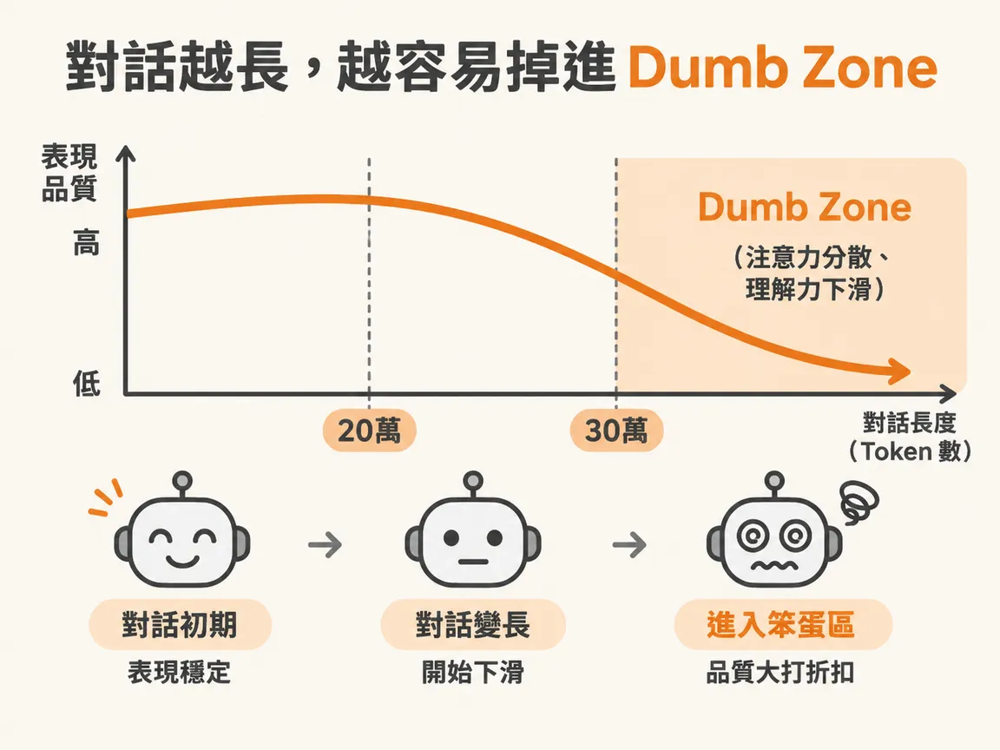
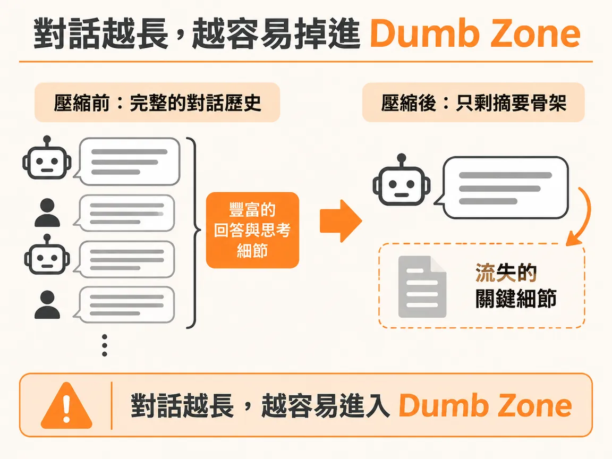

# 單一 Grilling Session 的極限：從 Dumb Zone 到失去整體形狀

當你可以把想做的功能直接交給 AI agent，讓它自行完成開發時，開發流程的瓶頸就徹底轉變了。此時的限制不再是「如何把程式碼寫出來」，而是「如何把工作規劃妥當」。

為了讓手邊所有的 agent 都有事情做，我們必須規劃出規模夠大的工作區塊，足以餵飽這些運算資源。然而，當我們嘗試使用盤問（grilling）的方式來梳理規格時，很快就會遇到單一對話階段（session）的天花板。

## 對話越長，越容易掉進 Dumb Zone

Grilling 的核心做法是透過 agent 不斷提問與互動，幫你釐清想建構的內容。但這種方式通常發生在同一個 session 之中。

隨著你回答越來越多問題、補充更多想法，對話長度會持續膨脹。一旦 token 數量累積到二十萬、三十萬以上，模型就會逐漸掉進「笨蛋區」（dumb zone），注意力分散、理解力下滑，產出的品質也大打折扣。

這時常見的困境在於：你很難直接對歷史紀錄做壓縮（compact）。這些對話記錄了你所有的回答與思考細節，價值極高；一旦經過摘要或壓縮，許多豐富且關鍵的上下文資訊就會隨之流失。

## 拆成多個 Session 的代價：手動切換與遺失整體形狀

既然單一 session 無法承受這麼龐大的對話量，常見的做法就是將任務拆開，在不同的 session 裡分別對不同部分進行盤問。

但這種拆法實務上非常痛苦。第一個 session 裡討論的問題，往往與第二個 session 密切相關；上下文一旦被切斷，彼此的關聯就很難維持。

這在需要動手做原型（prototype）時更為明顯。假設你在一個包含文件的 grilling session 中討論到一半，發現需要做個小原型驗證想法，你可能得另外開一個 prototype session 來試做，完成後再設法把成果倒回原本的 grilling session。這種頻繁在多個 session 之間來回搬移脈絡的手動管理方式，過程非常折磨。

更根本的問題在於：要將問題拆成多個 session，你必須在動手之前就預先掌握整套架構與需求的「整體形狀」（shape），才能判斷該拆成幾個部分。然而，我們之所以一開始需要透過 grilling 梳理思緒，往往正是因為還看不清問題全貌。要求在規劃初期就精準拆分 session，在邏輯上正好本末倒置。
