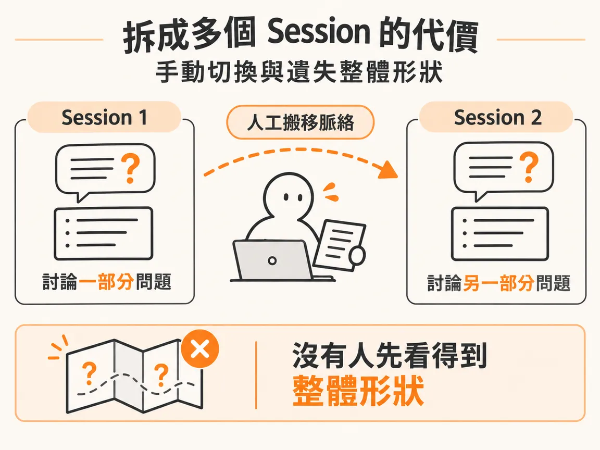

# 單一 Grilling Session 的極限：從 Dumb Zone 到失去整體形狀

把想做的功能直接交給 AI agent 自行開發時，開發流程的瓶頸就徹底改變了。

現在的限制不再是如何寫出程式碼，而是如何把工作規劃妥當。

要讓手邊所有的 agent 都有事可做，就得規劃出夠大的工作區塊，餵飽這些運算資源。

然而，一旦嘗試用盤問（grilling）的方式梳理規格，很快就會撞上單一 session 的容量天花板。

## 對話越長，越容易掉進 Dumb Zone

Grilling 的核心做法，是讓 agent 不斷提問與互動，藉此釐清想建構的內容。

這種互動通常都在同一個 session 裡進行。

回答的問題越多、補充的想法越雜，對話長度就會持續膨脹。

一旦 token 數量累積到二十萬、三十萬以上，模型就會逐漸掉進「笨蛋區」（dumb zone）。

這時它的注意力開始發散，理解力明顯下滑，產出品質也大打折扣。

此時很難直接對歷史紀錄做壓縮（compact）。

這些對話完整記錄了所有回答與思考細節，價值極高。

一旦經過摘要或壓縮，許多豐富且關鍵的上下文資訊就會隨之流失。

## 拆成多個 Session 的代價：手動切換與遺失整體形狀

單一 session 無法承受龐大對話量時，常見的做法是把任務拆開。

也就是在不同的 session 裡，分別針對各個部分進行 grilling。

但這種切法在實務上非常痛苦。

第一個 session 裡討論的問題，往往與第二個 session 密切相關。

上下文一旦被切斷，各部分之間的關聯就很難維持。

這種問題在需要做原型（prototype）時更明顯。

在討論規格文件的 grilling session 途中，若需要做個小原型驗證想法，就必須另外開一個 prototype session 來嘗試。

試完之後，還得手動把成果搬回原本的 grilling session。

在多個 session 之間頻繁來回搬移脈絡，管理過程極度繁瑣。

更根本的問題在於切分的前提。

要把問題拆到多個 session，動手前就得預先掌握架構與需求的「整體形狀」（shape），才能判斷該怎麼拆。

然而，一開始需要 grilling，正是因為還看不清問題的全貌。

要求在規劃初期就精準拆分 session，在邏輯上完全本末倒置。
