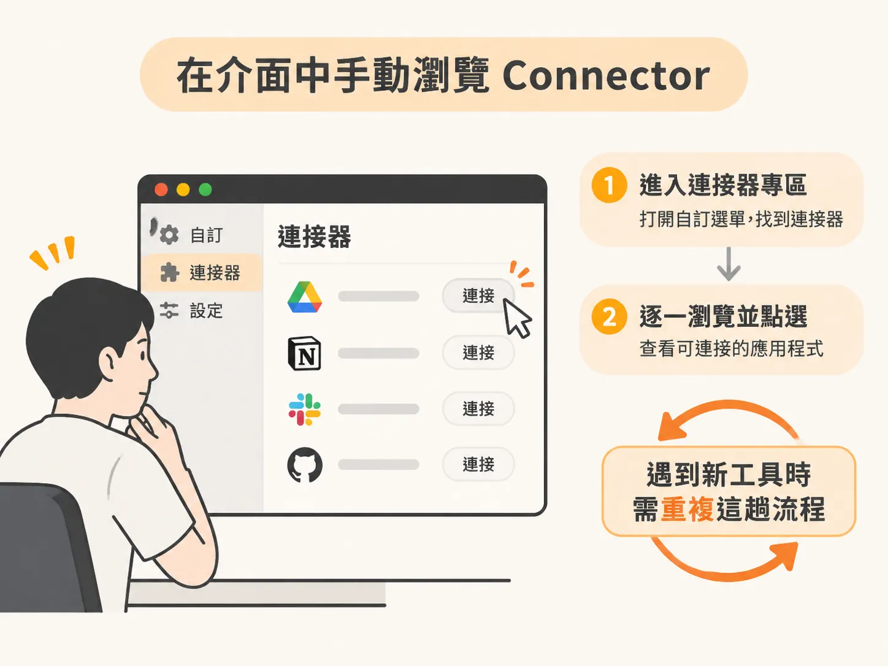
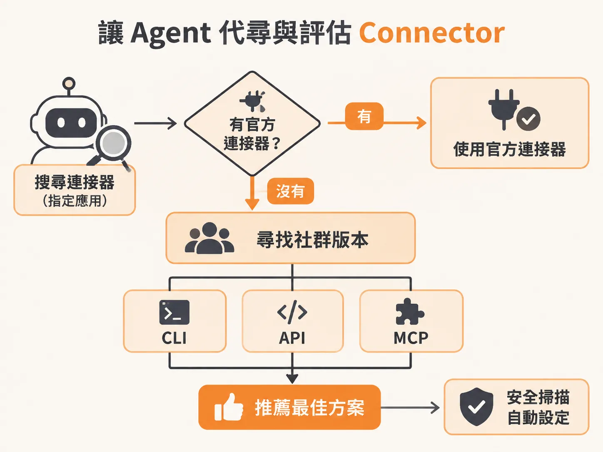
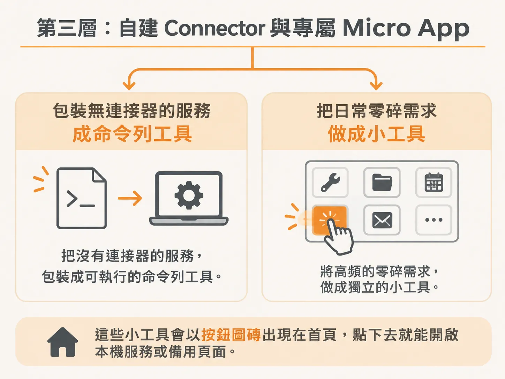

# 串接應用的三個層次：從手動瀏覽、Agent 代尋到自建 Micro App

要讓 AI Agent 真正投入日常工作、處理實際任務，關鍵就在於它能不能與外部應用程式相互串接。在搭建 Agent 作業系統時，應用層（Applications）的整合方式大致可以分為三個推進的層次：從最基本的手動瀏覽、交給 Agent 自動代尋，一路到自己動手打造專屬的連接器與 Micro App。

## 第一層：在介面中手動瀏覽 Connector

最直覺的串接方式，是直接開啟桌面端應用程式手動設定。以 Claude Code 桌面版為例，你可以進入自訂（Customize）選單下的連接器（Connectors）專區，逐一瀏覽目前有哪些能直接點選、連接的應用程式。



這種方法適合剛起步、想快速看看有哪些現成工具支援的使用者。不過在實務操作上，每遇到一個新工具就得離開工作流程、手動翻找清單，往往不是效率最高的做法。

## 第二層：讓 Agent 代尋與評估 Connector

第二個層次則是把搜尋與設定的工作交給 Agent 本身。與其由人類替 AI 到處找外掛，不如直接讓 Claude Code 自行代尋目前存在哪些可用的連接器。

常見的做法是給予 Agent 一個像是「搜尋連接器」（`search connectors`）的技能。當你指定某款應用時，它的運作邏輯如下：



1. **尋找官方版本**：優先檢查該應用軟體官方是否釋出專屬的連接器。
2. **搜尋社群替代方案**：若沒有官方連接器，就轉往社群尋找非官方工具。在 AI 串接應用的生態中，社群製作的連接器通常呈現為三種常見格式：
   - **CLI**（命令列介面）
   - **API**
   - **MCP**（Model Context Protocol）
3. **提供推薦並協助部署**：Agent 評估後會給出推薦方案。

以剪輯軟體 Adobe Premiere 為例，Agent 接收到搜尋需求後，會先確認 Adobe 官方是否有相應工具；如果沒有，它會進一步找出社群開發的開源方案，並推薦適合的 GitHub 儲存庫。接下來，你可以直接要求 Claude Code 掃描該開源專案以確認程式碼是否安全，並接著讓它自動完成配置，省去手動下載與編譯的麻煩。

## 第三層：自建 Connector 與專屬 Micro App

到了第三層，你的能力不再受限於市場上有沒有現成連接器，而是能進一步替特定需求自製工具。

### 自建連接器（Connector）

當你使用的服務完全沒有任何 Agent 連接器時，可以直接動手打造。一種實用的方式是運用 Lift 共同創辦人 Matt VH 提出的「CLI printing press」概念，把網頁操作或私有介面包裝成命令列工具。例如健康紀錄工具 MyFitnessPal 或社群平台 Skool，在缺乏現成生態支援的情況下，就能透過這種方法建立專屬的連接通道。

### 自建微型應用（Micro App）

除了連接現有的大型軟體，你還可以依據自己的工作習慣，讓 Agent 替你寫出各類輕量級的專屬微型應用（Micro Apps）。日常工作中有許多高頻但零碎的需求，很適合做成獨立的小工具：



- **素材瀑布流預覽**：把頻道或業務生成的所有圖片與影片集中在瀑布流（masonry grid）介面，方便快速預覽與挑選。
- **第二大腦（Second Brain）**：集中管理日常思緒、筆記與知識資產的專屬架構。
- **圖表產物中繼站（Landing Pad）**：讓 Agent 建立一個收集 Excalidraw 手繪示意圖的落地頁面，只要把生成的圖表產物貼上去，就能隨時依溝通情境取用。

在整合式作業系統中，這些微型應用會以按鈕圖磚（Tiles）的形式常駐在儀表板首頁。系統會檢查本機連接埠是否有回應；如果有，就直接載入本機服務，沒有則導向備用頁面，並同步記錄每一次開啟的紀錄：

<!-- source: sources/rubric/20261108/supplement/rubric-agentic-os-v2/refresh/lib/apps.cjs#L1-L17 -->

```javascript
/* The Micro Apps tiles on the homepage: RUBRIC Recos, then any apps you add in
   os-config.json ("microApps"). A tile opens the app when it answers on its port, and its
   fallback page when it does not. Every open is logged to data/app-opens.jsonl, which is how
   the Applications tab counts local app use. */
'use strict';
const fs = require('fs');
const path = require('path');

/* Where the RUBRIC Recos tile sends you when Recos is not running on this machine yet. */
const RECOS_CLASSROOM_URL = 'https://www.skool.com/robonuggets/classroom/7e082e48?md=79214f566e2044f5b74343c32780aad2';

const KIT = path.resolve(__dirname, '..', '..');
const BUILT_IN = [
  { id: 'recos', name: 'RUBRIC Recos', desc: 'Ways to improve your setup', url: 'http://localhost:50013/', port: 50013, fallbackUrl: RECOS_CLASSROOM_URL, icon: 'recos', builtIn: true },
];
const okUrl = u => /^https?:\/\/[^\s"'<>]+$/i.test(String(u || ''));
const okId = s => /^[a-z0-9][a-z0-9-]{0,40}$/.test(String(s || ''));
```

將這三個層次結合起來，從既有的連接器、自動化的搜尋安裝，再到補足缺口的自建 Micro App，就能拼出完整的應用層架構，打造出真正能分擔日常業務的 Agent 系統。
