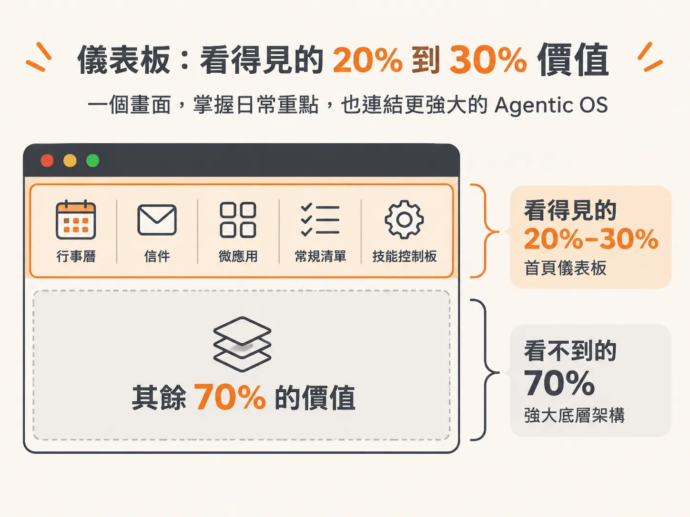
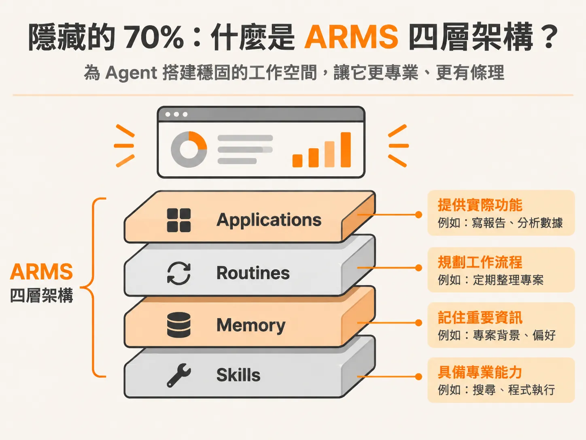
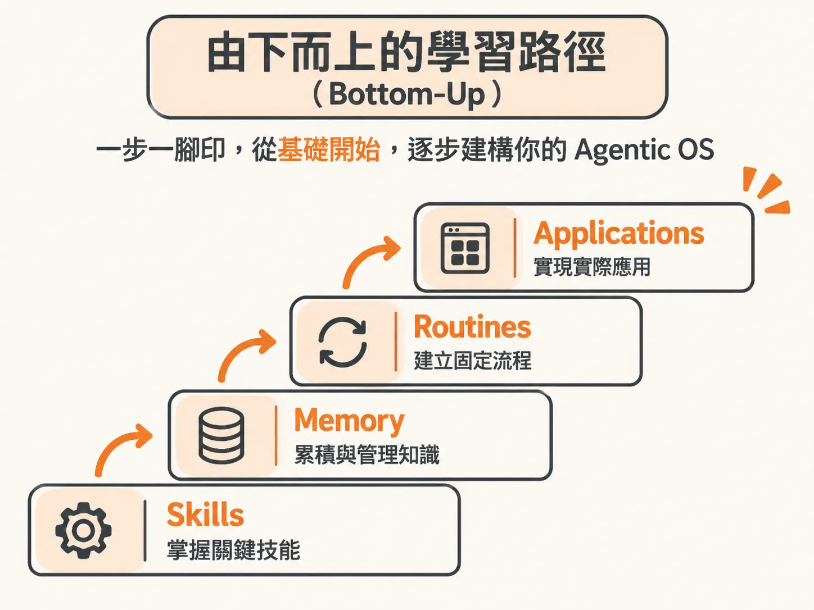

# 為什麼視覺儀表板只佔 Agentic OS 的三成價值？解構底層的 ARMS 架構

隨著 Claude 等新一代模型大幅進化，AI 的推論與工具調用能力比以往強大許多。然而多數人設定 AI Agent 與工作環境的方式，依然停留在舊思維：開啟一個對話視窗，遇到問題才臨時下提示詞。

為了完整發揮新模型的效能、降低運算成本並提升產出效率，我們需要一套完整的 Agentic OS（代理作業系統）。許多人剛接觸這套系統時，最先被吸引的往往是華麗的視覺儀表板，但這座看似功能齊全的指揮中心，其實只承載了整套系統兩到三成的價值。其餘七成的關鍵，全部藏在底層的架構之中。

---

## 儀表板：看得見的 20% 到 30% 價值

在日常工作環境中，視覺化的儀表板就像一座中央指揮中心，也是適合每天開啟的個人首頁。在單一畫面裡，你能看到幾項核心資訊：



- **日常應用摘要**：整合行事曆事件與跨時區時間，快速掌握當天行程。
- **信件處理狀態**：彙整電子郵件摘要，自動標出需要特別留意的重點信件。
- **微應用與小工具**：包含自己打造的微型工具捷徑，或是像 YouTube 數據這類的自訂監控小工具。
- **排程常規（Routines）**：清楚列出哪些自動化任務會在什麼時間點觸發執行。
- **技能控制板（Skills Deck）**：能針對特定技能直接調整努力程度（effort level）與選用模型，並在首頁一鍵啟動 Agent。
- **歷史成品環（Artifacts Ring）**：方便檢索 Agent 過去產出的所有檔案。例如搜尋特定客戶名稱「Stro Pro」，就能立刻調出 8 月 5 日生成的專屬 HTML 成品。
- **第二大腦（Second Brain）入口**：點擊中央球體（orb），就能切換至整個工作區的 3D 地圖、2D 地圖或時間軸，視覺化瀏覽所有檔案、技能、常規與應用。

在實作層面上，這些首頁小工具與應用程式會定期向本機伺服器同步資料：

<!-- source: sources/rubric/20261108/supplement/rubric-agentic-os-v2/os.html#L3190-L3211 -->

```javascript
/* a tile click logs the open (that is how the Applications tab counts local app use) and opens the app,
   or its page when the app is not running on this computer */
function openApp(id) {
  if (location.protocol !== 'http:') { toast('apps open when the OS runs (node server.js)'); return; }
  const w = window.open('about:blank', '_blank');
  fetch(API + '/api/app-open', { method:'POST', headers:{ 'Content-Type':'application/json' }, body: JSON.stringify({ id }) })
    .then(r => r.json())
    .then(d => { if (d.url && w) { w.opener = null; w.location.href = d.url; } else { if (w) w.close(); toast(d.error || 'could not open the app'); } })
    .catch(() => { if (w) w.close(); toast('server unreachable'); });
}
/* ---- pull everything, then keep it fresh ---- */
async function pullAll(first) {
  const jobs = [[pullCalendar,'calendar'], [pullArtifacts,'artifacts'], [pullRoutines,'routines'],
                [pullYoutube,'stats'], [pullEmail,'email'], [pullApps,'apps']];
  const out = await Promise.allSettled(jobs.map(([fn]) => fn()));
  out.forEach((r, i) => {
    if (r.status === 'rejected' && first) console.warn('offline:', jobs[i][1], r.reason?.message);
  });
  liveBadge(out.some(r => r.status === 'fulfilled'));
}
pullAll(true);
setInterval(() => pullAll(false), 120000);
```

這套介面完全執行在使用者自己的本機電腦上。初次設定時，只要把包含系統模板的壓縮檔交給 Claude Code，它就會自動掃描工作區、建立檔案索引，並串接所需的小工具；如果你原本已經在使用第一代 Agentic OS，Agent 也會先保留舊版運行，確認後再切換升級至 v2。

對從事 AI 諮詢或企業顧問的人來說，這類介面具備極佳的展示效果。例如為澳洲金融服務公司或 Bido Green 等客戶製作專案時，只要底層的工作區架構已經建立完整，就能依據客戶需求快速換上對應的模組與品牌風格，包裝成可落地的商業服務。

但如果只把精力放在美化介面，就本末倒置了。儀表板只是資訊呈現層，它之所以能順暢運作，全靠底層結構如何組織脈絡（context），讓 AI 是順著你的工作流推進，而不是隨處碰撞出錯。

---

## 隱藏的 70%：什麼是 ARMS 四層架構？

要讓 Claude Code 這種自主代理真正成為得力員工，必須替它搭建一套穩固的工作空間。這個骨架可以用 **ARMS** 四個字母來拆解，就像給予 Agent 靈活協同的四條手臂：



1. **A（Applications，應用層）**：你每天實際使用的微應用程式，或是讓 Agent 與外部軟體溝通的連接器（connectors）。
2. **R（Routines，常規層）**：不需人工介入、按照時間表定時觸發的自動化排程任務。
3. **M（Memory，記憶層）**：讓 Agent 記住個人偏好、工作限制、專案背景與過去互動歷史的記憶機制。
4. **S（Skills，技能層）**：封裝好的執行腳本或專業指令，定義 Agent 在特定情境下該如何執行任務。

這四個層級共同構成了支撐視覺儀表板的基石。如果沒有健全的記憶與技能，儀表板上的按鈕就只是無法落地的空殼。

---

## 由下而上的學習路徑（Bottom-Up）

建構自己的 Agentic OS 時，最理想的推進方式是「由下而上」：



1. **第一步：掌握 Skills（技能）**  
   先從單一、具體的任務開始。定義好指令範本與執行標準，讓 Agent 能夠穩定調用特定技能產出結果。

2. **第二步：建立 Memory（記憶系統）**  
   技能穩定後，為 Agent 補上工作區的脈絡背景與記憶規範。有了持久記憶，Agent 就不必在每次對話重新適應你的工作習慣與專案規則。

3. **第三步：串接 Routines（常規任務）**  
   當技能與記憶兼備，就可以設定定時任務，讓系統在特定時間自動執行重複性工作，例如每日摘要、數據抓取或例行清理。

4. **第四步：擴展 Applications（應用整合）**  
   最高層級則是打造客製化的微應用，或撰寫 API 連接器，將各項外部工具深度整合進自己的工作環境。

ARMS 架構中的每一個層級，實務上都可以進一步細分為三種不同的進階掌握程度。配合官方釋出的九頁設定指南，你可以直接將引導文件交給 Claude Code，讓 Agent 帶著你逐步由下而上搭建出符合個人需求的 Agentic OS。
