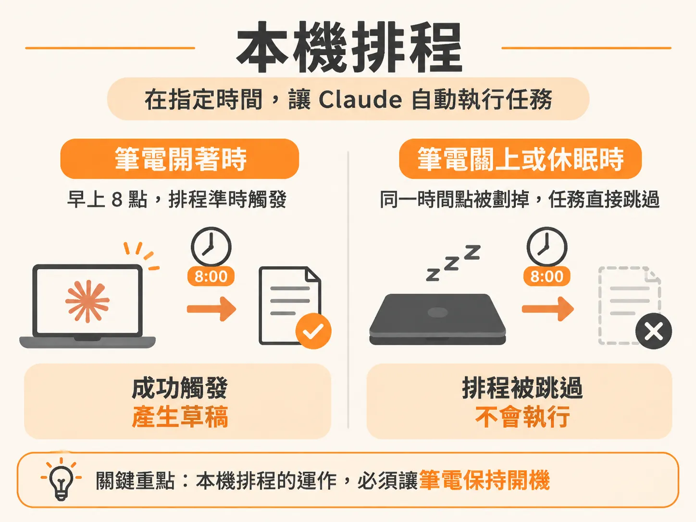
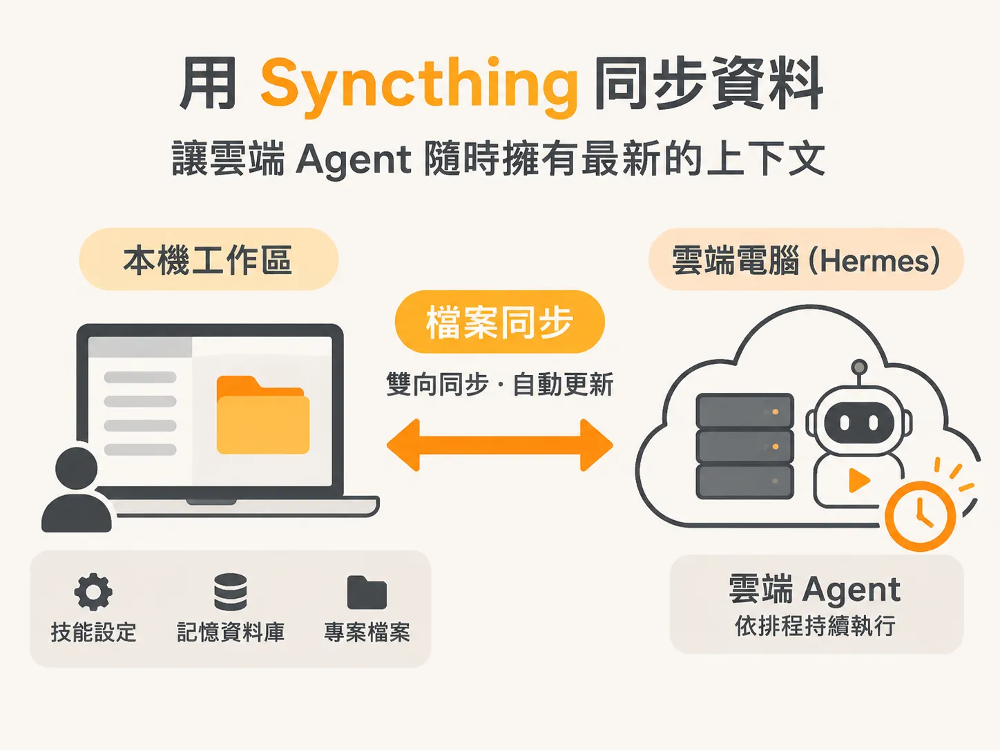
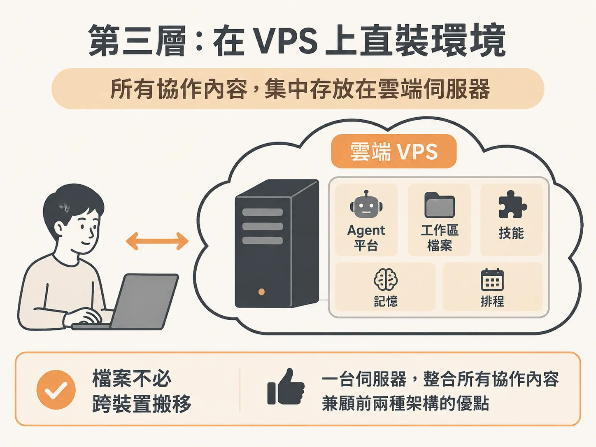

# AI Agent 的自動化排程：比較本機、常駐雲端與 VPS 三種 Routine 做法

當你掌握了讓 AI Agent 具備特定技能（Skills）與長期記憶（Memory）之後，下一步就是建立足夠的信任感，讓它在沒有你盯著的情況下自主執行任務。這就是自動化常規流程（Routines）的核心價值。

Routine 本質上就是「定時排程任務」。隨著自動化需求從簡單的日常整理演進到全年無休的背景處理，實作方式主要可分為本機排程、常駐雲端 Agent，以及在 VPS 上直接架設環境三種等級。了解這三種做法的運作原理與取捨，能幫助你挑選最適合目前工作流的架構。

## 第一層：本機排程（Local Routines）

最簡單的入門方式是直接使用 Claude Code 桌面應用程式內建的 Routine 功能。

在桌面應用的左側側邊欄中，你只需要用自然語言告訴 Claude 你想做什麼，就能直接草擬並建立排程。它的運作本質，就是 Claude 在你設定的特定時間，自動發送一段提示詞（Prompt）給自己執行。



以實際例子來說，你可以建立一個「YouTube to Substack daily」的排程，設定在每天早上 8:00 執行。這個 Routine 會自動檢查頻道上的最新影片，並依據你設定的語氣與風格，將內容改寫成電子報草稿，最後把產生的檔案放進 Agentic OS 的工作區中。當你坐到電腦前準備審閱時，打開檔案就能看到幾種不同的草稿版本供你挑選與微調。由於這項任務同時掛載了自訂的專用 Skill，產出的內容通常已經具備 70% 到 80% 的語氣精準度，只要稍微修改就能直接發布。

本機排程的優點是開箱即用、完全不需要伺服器知識。但它有一個致命的限制：**只有在你的電腦開機時才會執行**。一旦筆電闔上、電腦休眠或關機，所有的排程都會停擺。

## 第二層：常駐雲端 Agent（如 Hermes）

如果你希望即使個人電腦關閉，排程任務依然能照常運作，就必須進入第二層：將排程轉移到雲端環境。

現在市面上有不少常駐雲端的解決方案。例如 Open Claude 早期帶動了這種模式，但目前使用成本偏高；另一個常見的選擇是開源的 Hermes。

這類雲端 Agent 之所以能夠 24 小時全年無休運作，是因為使用者通常會替它配置一台專屬的雲端電腦。當任務移到雲端後，無論本機開機與否，排程都能準時觸發。

然而，這種架構會遇到一個關鍵問題：**雲端的 Hermes 該如何取得你在本機 Claude Code 中累積的所有 Skills 與記憶檔案？**

解決跨裝置資料存取最實用的工具是 Syncthing。它是一款免費且開源的檔案同步軟體，只要分別在你的本機工作區與 Hermes 所屬的雲端電腦上安裝並配對，就能自動將本地的技能設定、記憶資料庫與工作專案同步到雲端，讓常駐的雲端 Agent 隨時具備最新的上下文資訊。



這種做法解決了全天候運作的需求，但缺點在於你需要維護兩套系統（本機與雲端），而且必須依賴額外的同步工具來確保資料一致。

## 第三層：在 VPS 上直裝環境

第三層架構進一步簡化了跨系統的維護成本：直接租用一台虛擬私人伺服器（VPS），並把 Claude Code（或 Codex 等平台）直接安裝在該伺服器上。

在這個架構下，你與 AI 共同協作的所有檔案、技能、上下文與排程，都直接存放在這台位於雲端的虛擬電腦裡。這種做法兼具了前兩者的優點：



1. **全年無休**：排程直接在雲端伺服器上跑，完全不受個人電腦開關機影響。
2. **單一環境**：所有操作都在同一個平台上完成，不需要在多個不同的 Agent 之間轉換。
3. **免去檔案同步**：不需要額外設定 Syncthing 之類的第三方同步工具，上下文自然維持單一真理來源（Single Source of Truth）。

未來 OpenAI 或 Anthropic 很可能會以官方服務的形式原生提供這類雲端運作環境，但考量到使用者檔案儲存空間與伺服器安全權限，這項功能普及還需要一些時間。目前這依然是適合進階使用者手動配置的理想解法。

## 系統如何彙整不同來源的 Routine

當你的自動化任務分布在本機、伺服器或不同排程器時，儀表板工具（例如 Agentic OS）會需要統一的介面來呈現所有排程狀態。

如果使用 Claude Code，系統通常能直接讀取本機排程檔案，無須額外設定：排程任務清單會存放在 `~/.claude/scheduled-tasks/`，時間規律則由桌面應用的工作階段資料夾讀取。

若任務由其他 Agent、伺服器 cron 或雲端腳本觸發，最通用的做法是將排程寫入單一結構化設定檔（如 `snapshots/routines.json`）：

<!-- source: sources/rubric/20261108/supplement/rubric-agentic-os-v2/ROUTINES.md#L17-L31 -->

```json
{
  "timezone": "",
  "sources": [
    { "key": "agent",  "label": "MY AGENT" },
    { "key": "server", "label": "HOME SERVER" }
  ],
  "routines": [
    { "id": "morning-digest", "name": "Morning digest", "source": "agent",  "cron": "0 7 * * *", "desc": "Sum up my inbox and calendar" },
    { "id": "backup-sweep",   "name": "Backup sweep",   "source": "server", "days": ["mon", "wed", "fri"], "times": ["18:30"], "desc": "Copy the workspace to backup" },
    { "id": "inbox-check",    "name": "Inbox check",    "source": "agent",  "cron": "0 9-17 * * 1-5", "desc": "Hourly through the work day" },
    { "id": "weekly-review",  "name": "Weekly review",  "source": "agent",  "status": "ondemand", "desc": "Runs when I ask" }
  ]
}
```

透過統一的排程格式，無論你的任務是在本機執行、透過 Hermes 常駐監控，還是在獨立的 VPS 伺服器上運算，都能在同一份儀表板上一覽當天即將觸發的事件與倒數時間。
