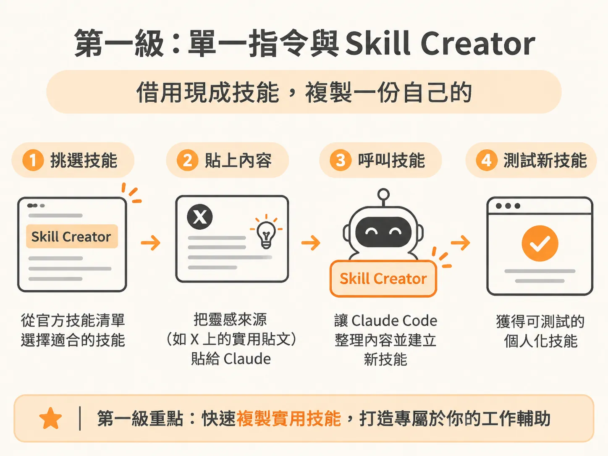
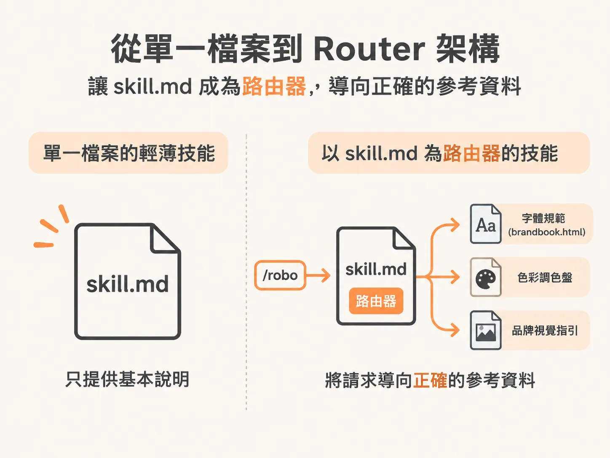
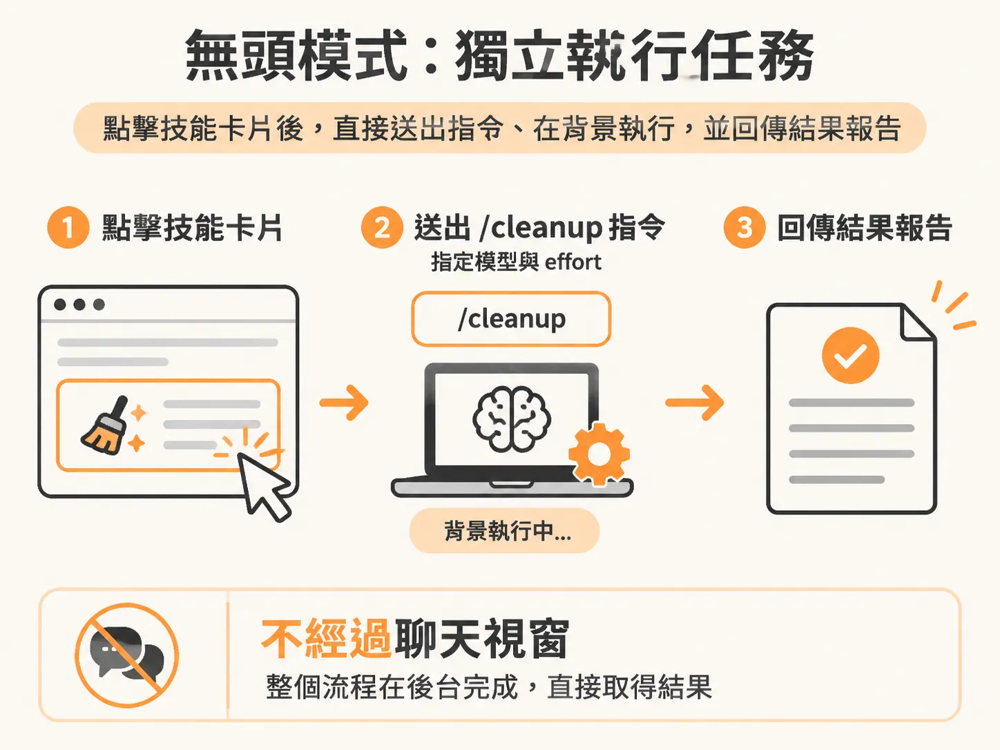

# 從重複 SOP 到 Router 架構：Skills 的三級成熟度

如果你發現自己為了同一個任務，向 Claude 下了兩次一模一樣或類似的提示詞，這就是將該流程製作成技能（Skill）的明確訊號。Skill 本質上就是標準作業程序（SOP）的捷徑。建立專屬的 Skill，能讓模型更快速產出貼合你工作習慣的精準成果。

隨著使用場景由淺入深，Skill 的運用方式通常會經歷三個成熟度階段。

## 第一級：單一指令與 Skill Creator

剛開始接觸時，多數人最先使用的是 Anthropic 預先建置好的技能。在 Claude 桌面應用程式的自訂（Customize）選單下，就能找到 Skills 專區瀏覽這些官方技能。

在官方清單中，最實用也最受歡迎的是 `skill creator`。每個人的工作流程都是高度客製化的，靈感往往來自日常生活中的操作片段。例如在社群平台 X 上看到一則讓電腦運作更順暢的實用小技巧，可以直接把整篇推文貼給 Claude，並呼叫 `skill creator` 技能。Claude Code 就會自動把推文內容整理成一個全新的技能供你測試。如果你的系統常因為 Claude Code 或 Codex 佔用資源而變慢，這類清理指令能發揮很直接的效果。



## 第二級：從單一檔案到 Router 架構

隨著測試過的技能越來越多，你會發現 Skill 檔不一定只能是單一的 Markdown 文件。

初期的輕薄型技能通常只包含一個 `skill.md`。這是一個純文字檔案，專門向 Claude Code 提供如何執行該指令的操作步驟。但當任務變得複雜，強大的技能往往需要依賴豐富的外部參考資料。

以設計為例，如果呼叫名為 `/robo` 的設計技能，它的資料夾內就不會只有一個檔案。該資料夾中的 `skill.md` 本質上扮演著「路由器」（Router）的角色，負責將請求導向同資料夾中的其他參考檔案。例如資料夾內放有 `brandbook.html`，裡面詳細記錄了字體規範、色彩調色盤與品牌視覺指引。



當任務需要產出具備設計感的公司資產時，這樣的視覺參考資料能發揮巨大作用。在製作 Agentic OS 的設定指南 PDF 時，只需要給出一個簡單的提示詞：

<!-- derived -->
```markdown
make a PDF guide with /robo on how to set up an agentic OS
```

接著回答 Claude 提出的幾個對齊意圖的問題，由於 `/robo` 已經定義了完整的視覺規範與參考文件，只要一到兩次對話，就能產出符合品牌設計的高品質 PDF，不需要在單一 `skill.md` 裡塞進所有規則。如果手上有過於肥大的技能，可以請 Claude 找出這些厚重的內容，將它們拆解成由 Router 指引的多檔案結構。

## 第三級：脫離聊天介面的無頭模式

當技能架構完備後，在某些情境下，你甚至不需要打開對話視窗來觸發它們。

以先前提到的系統清理技能為例，如果電腦效能變慢，不需要特地開一個終端機視窗或對話介面輸入 `/cleanup`。它可以直接被整合進儀表板或 Skills Deck 這類頁面中，點擊後即可在背景執行，完成後自動回傳一份摘要執行結果的報告。

這種在聊天對話之外獨立執行的機制，靠的是無頭模式（headless）工具 `claude -p`。它的原理是啟動一個快速的單次工作階段（one-shot prompt），並帶上你指定的模型與思考精力層級（effort level）。在上述例子中，發送給 Claude 的唯一指令就是 `/cleanup`。



儀表板在背後設定模型與執行環境時，對應的設定結構通常如下：

<!-- source: sources/rubric/20261108/supplement/rubric-agentic-os-v2/os-config.json#L6-L16 -->

```json
  "models": ["HAIKU", "SONNET", "OPUS", "FABLE"],
  "modelColors": ["#2aa88a", "#3f8fd4", "#9a66e0", "#ff6b1a"],
  "efforts": ["LOW", "MEDIUM", "HIGH", "XHIGH", "MAX"],
  "skills": [],
  "runner": {
    "command": "",
    "cwd": "",
    "modelValues": [],
    "effortValues": []
  },
  "microApps": [],
```

將技能提升到這個階段後，你就能把常用的 SOP 串接進內部的儀表板或自動化工具中。只要掌握 `claude -p` 的呼叫方式，不需要額外學習複雜的開發框架，就能讓重複的工作流程在背景穩定運轉。
