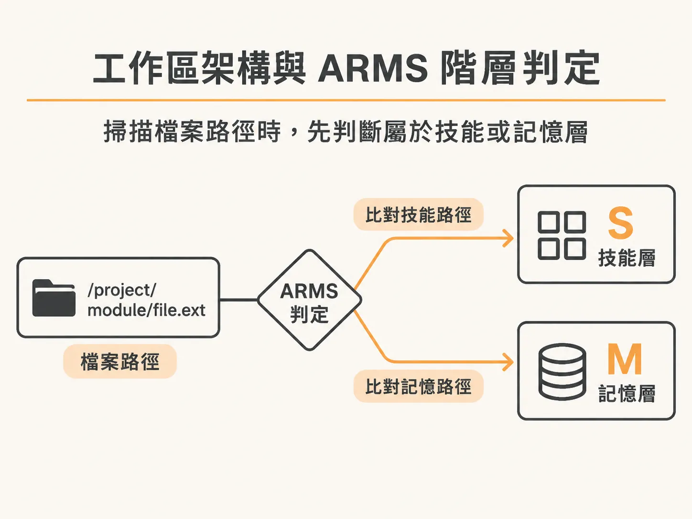
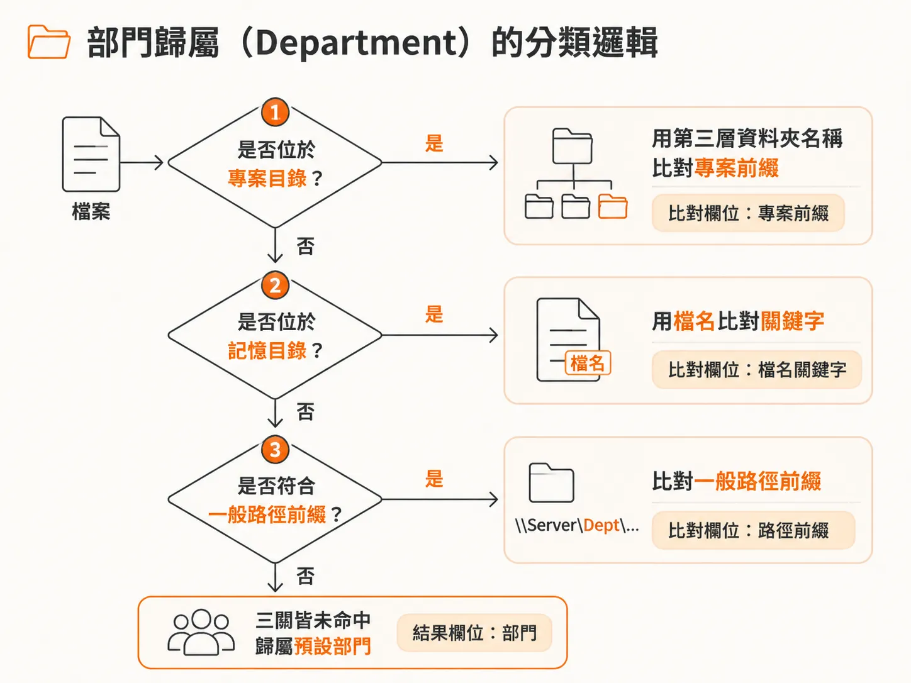
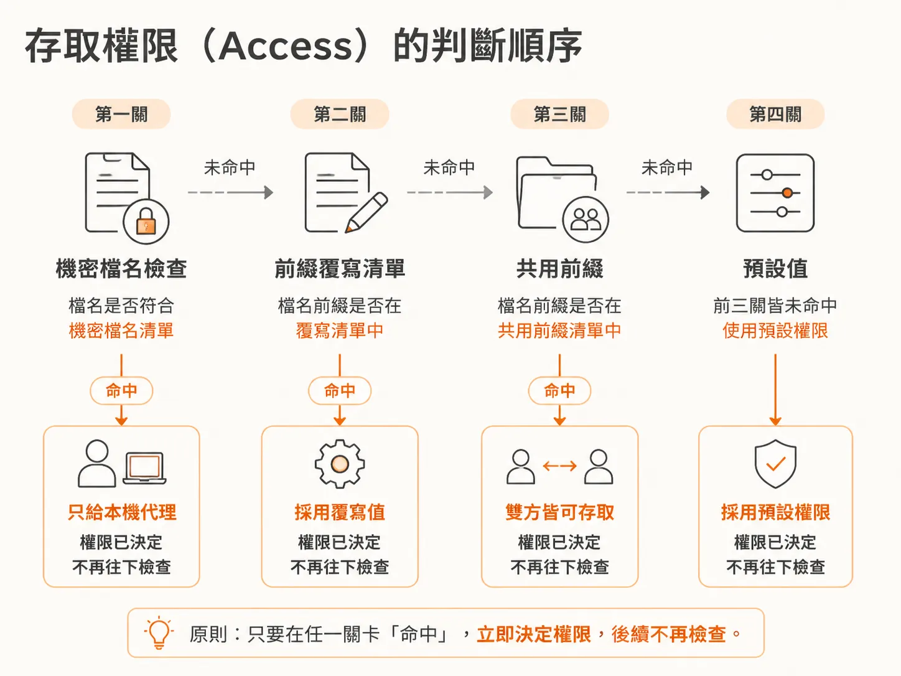
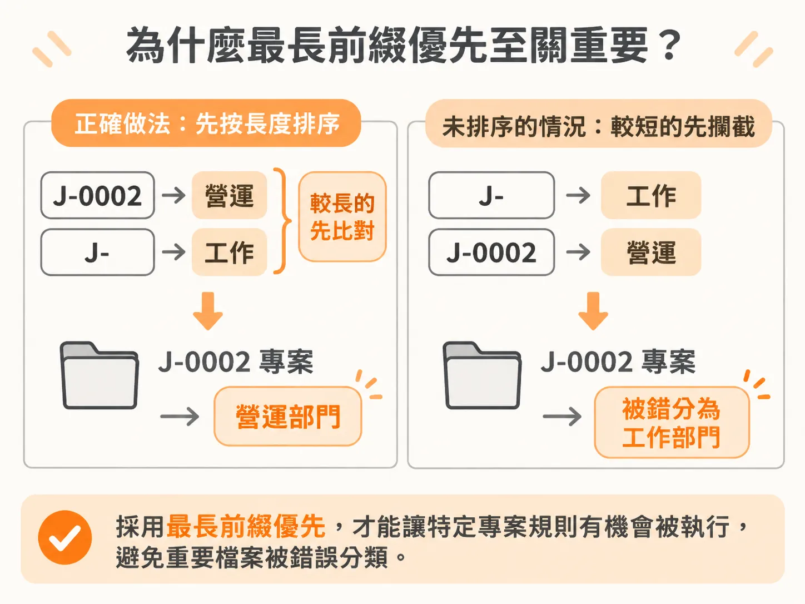

# Second Brain 檔案分類機制：部門、ARMS 與存取權限的判定優先序

當工作區裡累積了大量檔案、腳本與筆記時，若每次都要呼叫大型語言模型逐一判斷每個檔案的用途與權限，不僅非常昂貴，還會消耗大量 token 並增加出錯機率。

Second Brain 提供了解法：它是整個工作區的動態地圖，讓 AI 代理人能夠實際在其中穿梭導航。它將每個檔案、技能（skill）、記憶（memory）、例行工作（routine）以及已連接的應用程式，全部整合在同一個互動式圖表（interactive graph）中。透過明確的決定性程式碼（deterministic code），系統只需耗費極少量的 token 就能檢索並儲存事實，讓代理人迅速找到所需資料，並記住真正重要的事項。這套架構為整理與檢視龐大工作區提供了極佳的全貌視野。

要建立這張互動地圖，系統必須在掃描檔案時，透過一套嚴謹的規則將每個檔案分門別類。這套分類邏輯主要圍繞在三個維度：ARMS 階層、所屬部門，以及存取權限。

## 工作區架構與 ARMS 階層判定

在工作區設定中，系統會先定義關鍵目錄與可見根目錄：

<!-- source: sources/rubric/20261108/supplement/rubric-second-brain/config/workspace.json#L3-L22 -->

```json
  "root": "..",
  "memoryDir": "shared/memory",
  "memoryIndex": "MEMORY.md",
  "skillDirs": [
    ".claude/skills",
    ".claude/commands"
  ],
  "projectsDir": "shared/projects",
  "sharedPrefixes": [
    "shared/"
  ],
  "visibleRoots": [
    "",
    "shared",
    ".claude",
    "shared/memory",
    "shared/docs",
    "shared/projects",
    ".claude/skills"
  ],
```

當掃描器走訪檔案路徑時，會先依據 ARMS 架構判斷檔案屬於哪一種功能層級。在掃描邏輯中，檔案主要被區分為技能（Skill）與記憶（Memory）：



<!-- source: sources/rubric/20261108/supplement/rubric-second-brain/scan.js#L50-L61 -->

```javascript
function accessOf(rel, overrides) {
  if (isSecret(rel)) return 'claude';
  for (const o of overrides) if (rel.startsWith(o.prefix)) return o.access;
  for (const p of (WS.sharedPrefixes || ['shared/'])) if (rel.startsWith(p)) return 'both';
  return 'claude';
}

const SKILL_DIRS = (WS.skillDirs || ['.claude/skills', '.claude/commands']).map(d => d.replace(/\/+$/, '') + '/');
function layerOf(rel) {
  for (const d of SKILL_DIRS) if (rel.startsWith(d)) return 'S';
  return 'M';
}
```

`layerOf` 函式會檢查檔案路徑是否以 `.claude/skills` 或 `.claude/commands` 開頭。若是，該檔案就被標記為技能層（`S`）；若不是，則預設歸入記憶與資料層（`M`）。

## 部門歸屬（Department）的分類邏輯

除了功能層級，檔案還需要依業務範疇分配到不同的部門。系統預設支援多個常見部門，例如工作、內容、個人與營運：

<!-- source: sources/rubric/20261108/supplement/rubric-second-brain/config/departments.json#L4-L27 -->

```json
    {
      "key": "work",
      "label": "Work",
      "color": "#e040fb",
      "icon": "build"
    },
    {
      "key": "content",
      "label": "Content",
      "color": "#2196f3",
      "icon": "pen"
    },
    {
      "key": "personal",
      "label": "Personal",
      "color": "#fdd835",
      "icon": "people"
    },
    {
      "key": "operations",
      "label": "Operations",
      "color": "#b47aff",
      "icon": "coin"
    }
```

檔案究竟該屬於哪個部門，是由 `deptOf` 函式依循明確的路徑規則依序判斷：



<!-- source: sources/rubric/20261108/supplement/rubric-second-brain/scan.js#L63-L79 -->

```javascript
function deptOf(rel, name, cfg) {
  const d = cfg.dep;
  if (rel.startsWith((WS.projectsDir || 'shared/projects') + '/')) {
    const seg = rel.split('/')[2] || '';
    for (const [pre, dept] of d._prefixes) if (seg.startsWith(pre)) return dept;
    return d.default;
  }
  if (rel.startsWith((WS.memoryDir || 'shared/memory') + '/')) {
    const lower = name.toLowerCase();
    for (const rule of d.memoryKeywords || []) {
      if (rule.match.some(k => lower.includes(k))) return rule.dept;
    }
    return d.default;
  }
  for (const r of d.pathRules || []) if (rel.startsWith(r.prefix)) return r.dept;
  return d.default;
}
```

分類判定依序分為四個步驟：

1. **專案目錄判斷**：如果檔案位於 `shared/projects/` 底下，系統會取出代表專案名稱的第三層路徑，並比對預先設定的專案前綴清單（`_prefixes`）。只要前綴相符，就直接歸入對應部門。
2. **記憶目錄判斷**：如果檔案位於 `shared/memory/` 底下，系統會把檔名轉為小寫，逐一比對記憶關鍵字規則（`memoryKeywords`）。只要檔名包含指定關鍵字，便歸入相應部門。
3. **一般路徑比對**：若前兩者都不符合，系統會進一步檢查常規路徑前綴規則（`pathRules`），比對整個檔案路徑。
4. **預設回退**：若完全沒有命中任何規則，則直接套用預設部門（例如 `business`）。

## 存取權限（Access）的判斷順序

在多代理人或人機協作的環境中，保護機密資料與控制存取範圍至關重要。`accessOf` 函式定義了四道檢驗關卡：



1. **機密檔案優先**：只要被 `isSecret` 判定為敏感機密，存取權限立刻鎖定為 `claude` 專屬。
2. **手動覆寫規則**：比對 `access-overrides.json` 定義的前綴規則，符合者以覆寫設定為準。
3. **共用路徑放行**：路徑符合 `sharedPrefixes`（預設包含 `shared/`）的檔案，權限設為雙方皆可讀寫的 `both`。
4. **預設權限**：其餘路徑一律回退為 `claude`。

## 為什麼最長前綴優先（Longest-Prefix-First）至關重要？

在上述的所有規則比對中，「規則檢查的順序」直接決定了分類結果是否正確。

<!-- source: sources/rubric/20261108/supplement/rubric-second-brain/scan.js#L31-L42 -->

```javascript
function loadConfig() {
  const dep = loadJSON(path.join(CONFIG_DIR, 'departments.json'), { departments: [], layers: [], projectPrefixes: {}, pathRules: [], memoryKeywords: [], default: 'business' });
  const apps = loadJSON(path.join(CONFIG_DIR, 'apps.json'), { apps: [] }).apps;
  const routines = loadJSON(path.join(CONFIG_DIR, 'routines.json'), { routines: [] }).routines;
  const agentRoster = loadJSON(path.join(CONFIG_DIR, 'agents.json'), { agents: [] }).agents;
  const overrides = loadJSON(path.join(CONFIG_DIR, 'access-overrides.json'), { overrides: [] }).overrides;
  const tweaks = loadJSON(path.join(CONFIG_DIR, 'tweaks.json'), { hidden: [], edits: {} });
  // longest-prefix-first ordering so J-0002 beats J- style rules
  dep._prefixes = Object.entries(dep.projectPrefixes || {}).sort((a, b) => b[0].length - a[0].length);
  overrides.sort((a, b) => (b.prefix || '').length - (a.prefix || '').length);
  return { dep, apps, routines, agentRoster, overrides, tweaks };
}
```

在 `loadConfig` 載入設定時，程式特別對 `projectPrefixes` 與 `overrides` 做了由長到短的排序處理（`b.length - a.length`）。

這是因為前綴比對具備包含關係。假設今天有一個通用專案前綴 `J-` 對應到「工作」部門，但又有一個特殊專案 `J-0002` 需要被歸類到「營運」部門。如果未先按前綴長度排序，比對迴圈很可能會先比中較短的 `J-`，使得 `J-0002` 的特例規則永遠沒有機會執行。



同樣地，存取權限的覆寫規則也必須確保深層子路徑的長前綴能優先於淺層目錄生效。透過在載入時自動將規則依前綴長度降冪排列，系統便能確保具體的特例永遠優先於廣泛的通則，達到確定且不重複消耗模型資源的分類效果。
