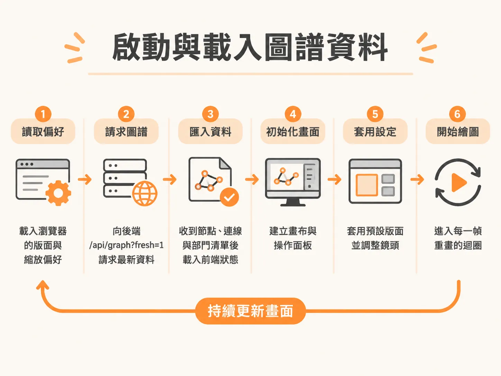
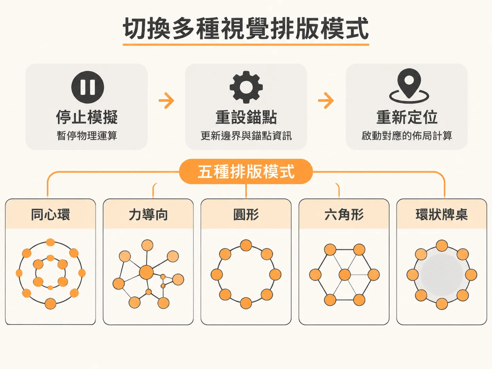
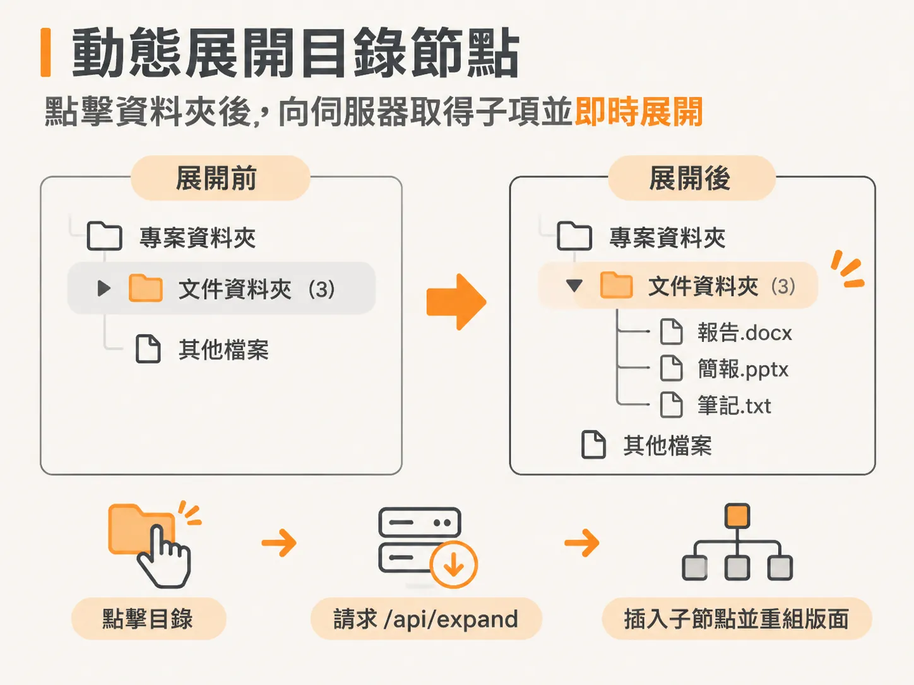
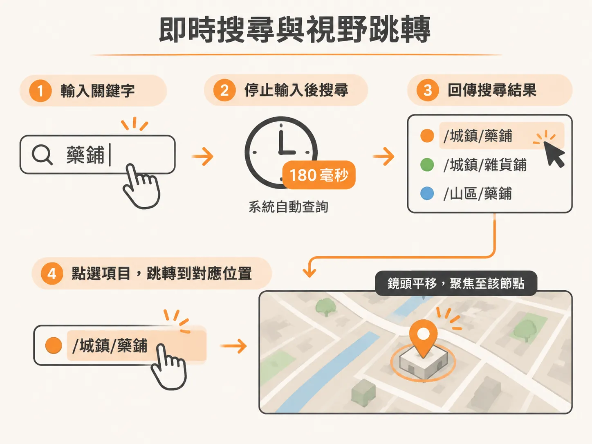

# 將工作區圖譜化為可導覽的互動地圖

當工作區裡累積了大量的檔案、技能（skills）、記憶（memories）、例行任務（routines）以及串接的應用程式時，AI 代理（agent）很容易在繁雜的目錄與龐大的上下文視窗中迷失。

Second Brain 提供了一個具體解法：把整個工作區繪製成一張代理能夠實際導覽的動態活地圖（living map）。在這張單一互動圖譜中，所有檔案、技能、記憶、例行任務與串接應用都化為節點。前端透過確定性（deterministic）的程式碼進行檢索與儲存，只耗費傳統做法極少比例的 token，就能讓代理迅速找到所需資料，並精準記住真正重要的事物。

要讓這份圖譜既能直觀呈現，又具備良好的瀏覽效能，前端需要經歷初始化載入、排版切換、節點動態展開與全文檢索四個核心階段。

## 啟動與載入圖譜資料

前端進入系統時，第一步是向後端取得最新的工作區模型結構，並初始化繪圖畫布與攝影機視野。

<!-- source: sources/rubric/20261108/supplement/rubric-second-brain/public/_core.js#L39-L63 -->

```javascript
  async function boot(skin) {
    S.skin = skin;
    S.theme = localStorage.getItem('robo-theme') || skin.defaultTheme || 'dark';
    const persisted = JSON.parse(localStorage.getItem('brain-v2-' + skin.key) || '{}');
    S.st = Object.assign({}, DEFAULT_ST, skin.st || {}, persisted);
    buildDOM();
    applyTheme();
    splash(true, 'Scanning the workspace');
    let data;
    try {
      const r = await fetch('/api/graph?fresh=1');
      data = await r.json();
      if (data.error) throw new Error(data.error);
    } catch (e) {
...
    }
    ingest(data);
    splash(false);
    initCanvas();
    buildPanels();
    setLayout(S.st.layout, true);
    resetCam(80);
    loop();
  }
```

`boot` 函式先讀取儲存在瀏覽器的偏好設定，接著向後端 `/api/graph?fresh=1` 請求圖譜資料。資料成功匯入後，隨即初始化畫布與操作面板，並套用預設的版面配置與攝影機縮放位置，最後啟動主繪圖迴圈。



## 切換多種視覺排版模式

為了讓讀者或代理從不同維度檢視關聯，同一份節點與連線資料可以套用不同的版面幾何規則，例如同心圓環（rings）或物理力導向圖（force layout）。

<!-- source: sources/rubric/20261108/supplement/rubric-second-brain/public/_core.js#L311-L325 -->

```javascript
  function setLayout(kind, first) {
    S.st.layout = kind; persistSt();
    if (S.sim) { S.sim.stop(); S.sim = null; }
    S.simKind = '';
    S.boundGeom = null;
    S.layoutEpoch++;
    S.anchors = anchorsFor();
    const anchorColor = {}; S.anchors.forEach(a => anchorColor[a.key] = a.color);
    S.anchorColor = anchorColor;
    if (kind === 'rings') initRings();
    else buildSim(kind);
    syncSegButtons();
    const names = { rings: 'Rings layout', force: 'Force layout', circle: 'Circle layout', hex: 'Hexagon layout', deck: 'Deck layout' };
    if (!first) toast(names[kind] || kind);
  }
```

切換排版時，`setLayout` 會先停止目前正在運行的物理模擬（simulation），重設邊界幾何與錨點資訊，接著根據選擇的模式（如 rings、force、circle、hex 或 deck）啟動對應的定位計算。這樣一來，使用者就能在幾何層次結構與自由力導向之間無縫切換。



## 動態展開目錄節點

如果一開始就把工作區的所有深層檔案全數載入，不僅會拖慢前端渲染，也會讓畫面過度擁擠。因此，前端只在使用者點擊資料夾時，才動態向伺服器拉取子節點。

<!-- source: sources/rubric/20261108/supplement/rubric-second-brain/public/_core.js#L195-L208 -->

```javascript
  async function expandDir(id, quiet) {
    const dir = S.byId.get(id);
    if (!dir || dir.type !== 'dir' || dir.expanded) return;
    let data;
    try {
      const r = await fetch('/api/expand?path=' + encodeURIComponent(id));
      data = await r.json();
      if (data.error) { toast(data.error); return; }
    } catch (e) { toast('Expand failed: ' + e.message); return; }
    insertChildren(dir, data.nodes);
    reaggregate();
    refreshLayout(0.5);
    if (!quiet) toast('Expanded ' + dir.label + ' - ' + data.nodes.length + ' items');
  }
```

當使用者點擊尚未展開的目錄時，`expandDir` 會呼叫後端的 `/api/expand` 端點。取回子節點後，再將它們插入全域模型中，並觸發局部重組與排版重新計算，平滑更新視野。



## 即時搜尋與視野跳轉

除了手動點擊節點探索，地圖也支援以關鍵字快速定位。

<!-- source: sources/rubric/20261108/supplement/rubric-second-brain/public/_core.js#L1489-L1513 -->

```javascript
    // search
    const input = document.getElementById('brain-search');
    const results = document.getElementById('brain-results');
    let debounce = null;
    input.oninput = () => {
      clearTimeout(debounce);
      debounce = setTimeout(async () => {
        const q = input.value.trim();
        if (!q) { results.innerHTML = ''; results.style.display = 'none'; return; }
        const r = await fetch('/api/search?q=' + encodeURIComponent(q));
        const d = await r.json();
        results.style.display = 'block';
        results.innerHTML = d.results.slice(0, 14).map(x => `
          <div class="res" data-path="${escapeAttr(x.path)}" data-type="${x.type}">
...
            <span class="r-path">${x.path}</span>
          </div>`).join('') || '<div class="res-none">No hits</div>';
        results.querySelectorAll('.res').forEach(el => el.onclick = () => {
          results.style.display = 'none'; input.value = '';
          jumpTo(el.dataset.path);
        });
      }, 180);
    };
    input.onblur = () => setTimeout(() => { results.style.display = 'none'; }, 250);
```

搜尋輸入框綁定了防抖（debounce）機制，在使用者停止輸入 180 毫秒後，向 `/api/search` 查詢相符節點。搜尋結果會標上對應的顏色與路徑標籤，點擊任一項目後，畫面便會直接呼叫 `jumpTo`，將攝影機鏡頭平移聚焦到該節點上。



## 後端展開與搜尋介面

前端所依賴的展開與搜尋功能，由後端輕量 API 提供支援：

<!-- source: sources/rubric/20261108/supplement/rubric-second-brain/server.js#L103-L117 -->

```javascript
    if (p === '/api/expand' && req.method === 'GET') {
      const r = await (scanPromise || startScan());
      if (r.error) return sendJSON(res, { error: r.error }, 500);
      const rel = (url.searchParams.get('path') || '').replace(/\\/g, '/');
      const children = scan.expandDir(r.model, r.cfg, rel);
      if (!children) return sendJSON(res, { error: 'Unknown folder' }, 404);
      return sendJSON(res, { path: rel, nodes: children });
    }

    if (p === '/api/search' && req.method === 'GET') {
      const r = await (scanPromise || startScan());
      if (r.error) return sendJSON(res, { error: r.error }, 500);
      const q = url.searchParams.get('q') || '';
      return sendJSON(res, { q, results: scan.search(r.model, r.cfg, q, 40) });
    }
```

伺服器在收到請求時，會調用背景掃描快取的模型，直接進行路徑子樹的展開或是全文關鍵字比對，並回傳格式化後的節點清單，讓前端維持輕巧快速的互動體驗。
