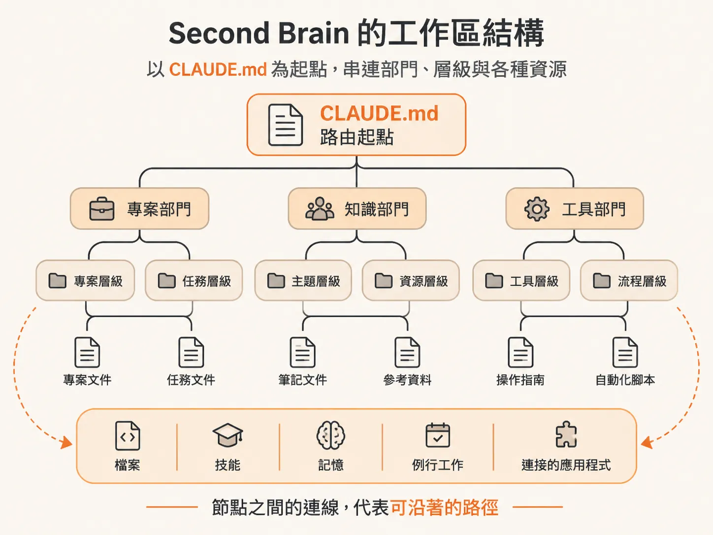
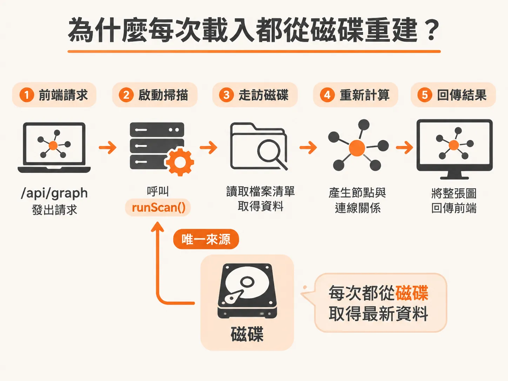
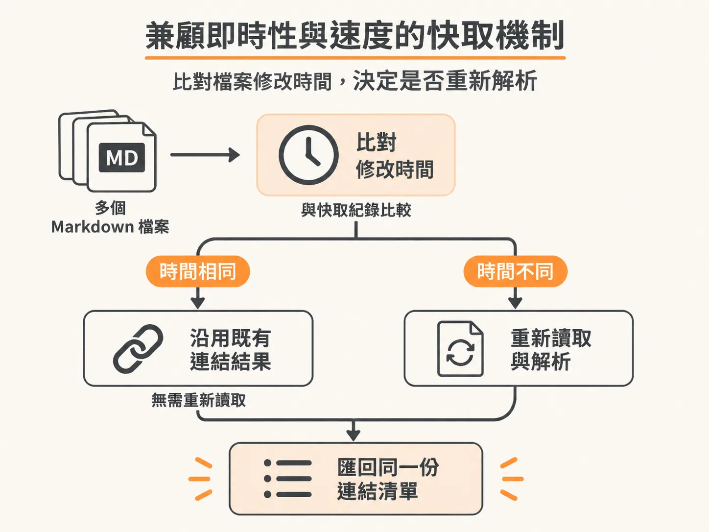

# Second Brain：工作區的動態地圖與磁碟重建機制

當專案規模逐漸擴大，要讓 AI Agent 清楚理解專案內部的所有脈絡往往是一大挑戰。Second Brain 提供了解法：它是整個工作區的動態地圖（living map），也是 Agent 實際導航與巡訪的依據。

在這張互動式圖表（interactive graph）中，你可以一眼看清每個檔案（file）、技能（skill）、記憶（memory）、例行工作（routine）以及連接的應用程式（connected app）。透過確定性程式碼（deterministic code）來檢索與儲存事實，系統只需要耗費一小部分 token，就能讓 Agent 迅速找到所需資料，並記住真正重要的細節。本篇教學便要深入解析這套工具的核心運作方式。

## 這張圖代表什麼

Second Brain 的本質是一個描述檔案與組織架構的關聯圖。在底層建構圖形時，系統會以根目錄的 `CLAUDE.md` 作為整個工作區的路由起點（router），接著連結到各個部門（department hubs）與層級（layer hubs），最後串接起實際的檔案節點與導航路徑：



<!-- source: sources/rubric/20261108/supplement/rubric-second-brain/scan.js#L196-L316 -->

```javascript
function buildGraph(model, cfg) {
  const { files, dirs } = model;
  const nodes = [];
  const push = n => { nodes.push(n); return n; };

  // router
  push({ id: 'CLAUDE.md', type: 'router', layer: 'M', label: 'CLAUDE.md', dept: 'business', access: 'both', size: sizeOf(files, 'CLAUDE.md'), path: 'CLAUDE.md' });

  // department hubs (context view anchors) + layer hubs
  for (const d of cfg.dep.departments) push({ id: 'hub:' + d.key, type: 'hub', hubKind: 'dept', layer: 'M', label: d.label, dept: d.key, access: 'both' });
  for (const l of cfg.dep.layers) if (l.key !== 'M') push({ id: 'lhub:' + l.key, type: 'hub', hubKind: 'layer', layer: l.key, label: l.label, dept: null, access: 'both' });
...
  // structural links
  const links = [];
  for (const d of cfg.dep.departments) links.push({ s: 'CLAUDE.md', t: 'hub:' + d.key, k: 'route' });
  for (const l of cfg.dep.layers) if (l.key !== 'M') links.push({ s: 'CLAUDE.md', t: 'lhub:' + l.key, k: 'route' });
...
  return { nodes: nodesOut, links: linksOut, visible, hiddenCount: hid.size };
}
```

透過這種層級結構，不論是業務規則、技能腳本還是專案設定，都會被組織成清晰的節點與邊，讓 Agent 在檢索時不必盲目搜尋全文，而是能沿著結構化路徑逐步抵達目標檔案。

## 為什麼每次載入都從磁碟重建

在實際開發中，工作區的檔案隨時會被新增、修改或刪除。如果將圖形資料硬編碼存入靜態資料庫，很容易在檔案變更後產生資訊不同步。

因此，Second Brain 選擇在前端請求圖形資料時，直接在伺服器端觸發磁碟掃描，即時重建整張圖：

<!-- source: sources/rubric/20261108/supplement/rubric-second-brain/server.js#L88-L101 -->

```javascript
    if (p === '/api/graph' && req.method === 'GET') {
      if (url.searchParams.get('fresh') === '1' && !freshEnough()) startScan();
      if (!scanPromise) startScan();
      const r = await scanPromise;
      if (r.error) return sendJSON(res, { error: r.error }, 500);
      return sendJSON(res, {
        meta: { ...r.meta, port: PORT },
        departments: r.cfg.dep.departments,
        layers: r.cfg.dep.layers,
        nodes: r.graph.nodes,
        links: r.graph.links,
        mdLinks: r.mdLinks,
      });
    }
```

每當前端發出 `/api/graph` 請求，伺服器就會呼叫 `runScan()`，即時走訪磁碟目錄、讀取檔案清單並重新計算節點：



<!-- source: sources/rubric/20261108/supplement/rubric-second-brain/scan.js#L322-L346 -->

```javascript
function runScan() {
  const t0 = Date.now();
  const cfg = loadConfig();
  const model = walk(ROOT);
  const cache = loadJSON(CACHE_FILE, {});
  const { links: mdLinks, newCache, stats } = extractLinks(model.files, cache);
  try {
    fs.mkdirSync(path.dirname(CACHE_FILE), { recursive: true });
    fs.writeFileSync(CACHE_FILE, JSON.stringify(newCache));
  } catch { }
  const graph = buildGraph(model, cfg);

  // md links attach at file level; the client re-targets endpoints that sit
  // inside folded folders to their deepest visible ancestor
...
    cfg, model, graph, mdLinks,
    meta: {
      scannedAt: new Date().toISOString(), scanMs,
      totalFiles: model.files.length, totalDirs: model.dirs.size,
      mdParsed: stats.mdParsed, mdRead: stats.read, mdCached: stats.cached,
      visibleNodes: graph.nodes.length, mdLinks: mdLinks.length, hiddenCount: graph.hiddenCount || 0,
    },
  };
}
```

## 兼顧即時性與速度的快取機制

直接走訪磁碟確保了圖形永遠呈現最新狀態，但如果每一次都要逐一剖析所有 Markdown 檔案的內部連結，效能會受到很大影響。

為了在「即時反映現狀」與「降低 I/O 開銷」之間取得平衡，系統在萃取 Markdown 內部連結時引入了修改時間（mtime）快取機制：

<!-- source: sources/rubric/20261108/supplement/rubric-second-brain/scan.js#L129-L175 -->

```javascript
function extractLinks(files, cache) {
  const mdFiles = files.filter(f => f.ext === '.md' && f.size <= MD_MAX_READ);
  // basename -> [rels] for wiki-link resolution
  const base = new Map();
  for (const f of mdFiles) {
    const key = f.name.slice(0, -3).toLowerCase();
    if (!base.has(key)) base.set(key, []);
    base.get(key).push(f.rel);
  }
  const relSet = new Set(files.map(f => f.rel));
  const out = [];      // [srcRel, tgtRel]
  const newCache = {};
  let read = 0, cached = 0;

  for (const f of mdFiles) {
    const c = cache[f.rel];
    let raw;
    if (c && c.m === f.mtime) { raw = null; cached++; newCache[f.rel] = c; }
    else {
...
  return { links: out, newCache, stats: { mdParsed: mdFiles.length, read, cached } };
}
```

掃描過程中，系統會比對每個 Markdown 檔案在磁碟上的修改時間與快取紀錄。只有內容被更動過的檔案才會重新讀取與解析，未修改的檔案則直接沿用先前的解析結果。



這樣一來，每次載入不僅能確保工作區變動即時反映在地圖上，也能在幾毫秒內迅速完成重建，提供穩定的檢索支援。
