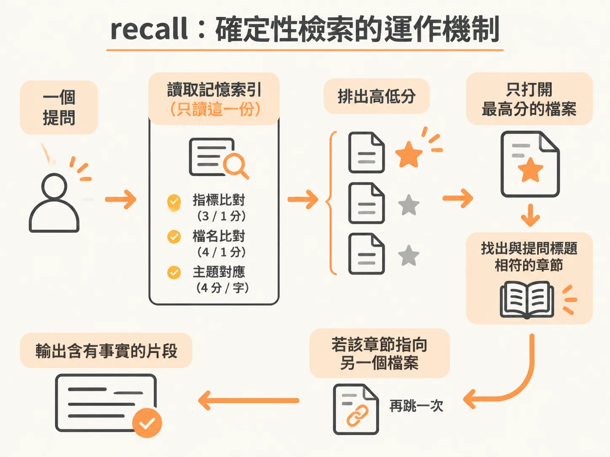
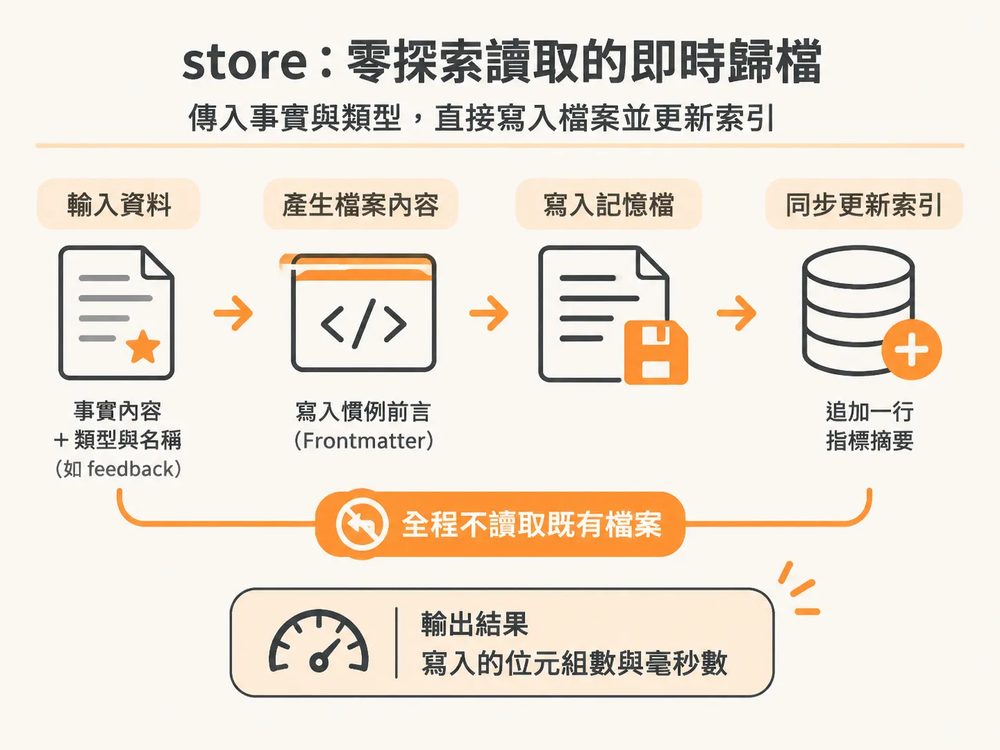
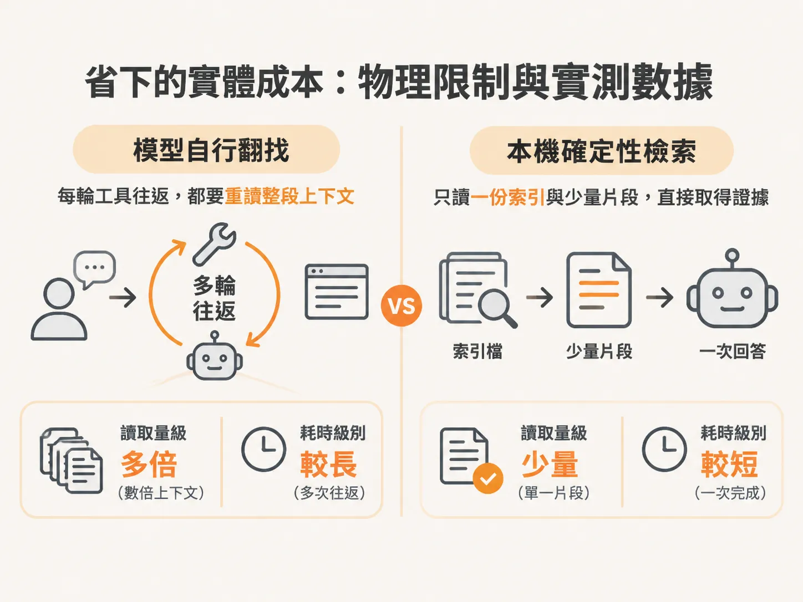

# 將記憶檢索移出模型：用 bytes 與毫秒計算的檢索成本

當我們讓 AI 助理（Agent）管理專案記憶、決策與設定時，最常見的做法是讓模型自己呼叫工具去翻目錄、搜尋檔案。但只要觀察對話的回合數就會發現，模型每次使用工具搜尋，都必須把整段上下文連同工具呼叫的紀錄重新讀取一遍。一個原本只需確認一行決策的提問，往往耗掉數萬個 token、花費十幾秒來來回回探索。

Second Brain 提供了一個把工作區視為動態地圖的架構。它將整個工作區的所有檔案、技能、記憶、例行任務（routine）以及連接的應用程式呈現為單一互動圖譜（interactive graph）。核心理念很直接：讓確定性程式碼（deterministic code）負責擷取與儲存事實，僅使用極少比例的 token，讓 Agent 能快速找到所需資訊，並牢牢記住關鍵重點。

實作這個理念的工具，例如 `brain.js` 引擎，其核心設計是將檢索與寫入搬到模型外部執行。引擎內部完全沒有任何大型語言模型（LLM）的 API 呼叫，不只消除了額外的 API 計費，也將檢索與儲存的成本從計算 token 轉移為計算讀寫的位元組數（bytes）與執行毫秒數（ms）。

## recall：確定性檢索的運作機制

傳統上，Agent 找資料常仰賴廣泛的檔案搜尋（Grep）或反覆讀取多個資料夾。`recall` 則改採確定性的啟發式評分邏輯。在檢索時，它一律只強制讀取一個檔案——記憶索引（`MEMORY.md`）。

<!-- source: sources/rubric/20261108/supplement/rubric-second-brain/brain.js#L39-L62 -->

```javascript
function recall(query, opts) {
  opts = opts || {};
  const t0 = performance.now();
  let bytes = 0;
  const read = p => { const s = fs.readFileSync(p, 'utf8'); bytes += Buffer.byteLength(s); return s; };
  const qw = words(query);

  // 1) index hop: MEMORY.md is the hub and the ONLY always-read file
  //    (category indexes stay closed - filenames cover their contents)
  const pointers = []; // {file, score, line}
  const hub = path.join(MEM, MEM_INDEX);
  if (fs.existsSync(hub)) {
    for (const line of read(hub).split('\n')) {
      const m = line.match(/\[([^\]]+)\]\(([^)]+)\)/);
      if (!m) continue;
      const lw = words(line);
      let score = 0;
      for (const w of qw) {
        if (lw.includes(w)) score += 3;
        else if (lw.some(x => x.startsWith(w) || w.startsWith(x))) score += 1;
      }
      if (score > 0) pointers.push({ file: path.resolve(MEM, m[2]), score, line: line.trim() });
    }
  }
```

讀取記憶索引後，程式會比對問題中的單詞與索引內的每一條指標（完整單詞相符得 3 分，前綴相符得 1 分）、記憶檔案名稱（完整相符得 4 分，部分相符得 1 分），以及分類主題對應表（每個主題字得 4 分）。



接著，程式只開啟得分最高的那份記憶檔案，擷取標題與提問單詞相符的章節；如果沒有精確符合的標題，則取文字密度最高區塊的上下文視窗。若該章節指向另一個檔案，程式只會順著指標再跳轉一次（one pointer hop），確保最後回傳給模型的證據直接包含事實本身，而不是事實的存放路徑。

這樣的流程讓檢索過程不需經過神經網路推論，典型的代價大約僅是讀取約 20KB 的檔案、耗時約 5 毫秒，且消耗 0 個模型 token。

## store：零探索讀取的即時歸檔

讓模型自己記筆記通常非常昂貴。為了決定把筆記寫在哪裡、如何排版，模型往往需要先讀取現有的筆記目錄與相關歷史文件，產生可觀的 token 消耗。

`store` 則將歸檔完全規則化。只要傳入事實內容、分類類型（如 `feedback`、`project`、`user` 或 `reference`）與檔案識別名稱，它便以程式碼直接寫入符合慣例的前言格式（Frontmatter），並同步在記憶索引檔追加該筆資料的摘要指標行。



<!-- source: sources/rubric/20261108/supplement/rubric-second-brain/brain.js#L163-L220 -->

```javascript
function store(fact, opts) {
  opts = opts || {};
  const t0 = performance.now();
  const type = opts.type || 'project';
  const name = (opts.name || words(fact).slice(0, 4).join('-') || 'note').toLowerCase().replace(/[^a-z0-9-]/g, '-');
  const dir = opts.sandbox ? SANDBOX : MEM;
  fs.mkdirSync(dir, { recursive: true });
  const prefix = { feedback: 'feedback_', project: 'project_', user: 'user_', reference: 'reference_' }[type] || '';
  const file = path.join(dir, prefix + name.replace(/-/g, '_') + '.md');
  const today = new Date().toISOString().slice(0, 10);
  // redact token-shaped strings so secrets never land in an always-loaded index line
  const safeFact = fact.replace(/\b(github_pat_|ghp_|sk-|xox[baprs]-|AIza)[A-Za-z0-9_\-]{10,}/g, '$1<redacted - full value in memory body>');
  const desc = safeFact.length > 110 ? safeFact.slice(0, 107) + '...' : safeFact;
...
  }
  const bytes = Buffer.byteLength(body) + Buffer.byteLength(entry);
  return { file: path.relative(ROOT, file), indexLine: entry.trim(), bytes, ms: +(performance.now() - t0).toFixed(2) };
}
```

在寫入過程中，程式還會主動辨識並隱藏敏感字串（如 GitHub PAT、API 金鑰等），避免密鑰暴露在隨時會被載入的索引行中。整個歸檔流程完全不需預先讀取任何舊檔案來「探索環境」，能在不到 1 毫秒內一口氣完成檔案建立與索引更新。

## 省下的實體成本：物理限制與實測數據

對話階段的計費物理機制其實很直觀：整場對話的總成本，大致等於「累積的上下文長度」乘以「工具互動的回合數」。模型每做一次工具往返（tool round-trip），系統就得把所有已經載入的上下文重新處理一遍。



`recall` 將資料篩選的工作搬到模型推論之前，搭配 `ask` 命令預先組裝好單回合提示詞（問題本身加上檢索出來的具體片段，並要求「引用行號、說出檔名」），直接將回答收斂至單一模型回合，不需要反覆搜尋確認。儲存事實時，更完全不必透過模型思考。

在實際命令列執行時，終端機回傳的不是抽象的提示詞計數，而是具體的系統資源開銷：

<!-- source: sources/rubric/20261108/supplement/rubric-second-brain/brain.js#L254-L265 -->

```javascript
  if (cmd === 'recall') {
    const r = recall(args.join(' '), { k: Number(flags.k) || 3 });
    for (const h of r.hits) {
      console.log(`\n=== ${h.file}  (score ${h.score})`);
      console.log(h.slice);
    }
    console.log(`\n[brain] ${r.hits.length} hits · ${r.bytes.toLocaleString()} bytes read · ${r.ms}ms`);
  } else if (cmd === 'store') {
    const r = store(args.join(' '), flags);
    console.log(`[brain] stored -> ${r.file}`);
    console.log(`[brain] index += ${r.indexLine}`);
    console.log(`[brain] ${r.bytes.toLocaleString()} bytes written · ${r.ms}ms · zero exploration reads`);
```

在實際工作區針對 8 組真實記錄對話的測試中，這種單回合路徑展現了明確的效益：相較於完全沒有預先載入工作區背景的標準 Claude，使用確定性檢索輔助的單回合流程減少了 78.6% 的 token 用量，並縮短了 84.5% 的時間，同時 8 題全部給出正確答案。

在儲存事實方面，傳統手動在對話階段讓模型探索、閱讀既有結構再寫入的流程，往往耗費 9 萬至 25 萬個 token；而確定性的 `store` 僅耗時約 0.1 秒、消耗 0 個 token。即便跟已經手動調校過的進階環境相比，這種單回合模式仍然把整體的 token 消耗砍了將近一半。

當然，這套機制也有明確的邊界：如果某項事實本來就已經存在於使用者平常自動載入的精簡索引中，直接在對話內回答反而是最快的，這代表常駐索引發揮了應有的效用。只有在涉及特定決策細節、設定或各類已歸檔的長期事實時，先執行確定性的 recall 與 store，才能將搜尋的沉重負擔從推論成本轉化為幾十 KB 與數毫秒的極小開銷。
