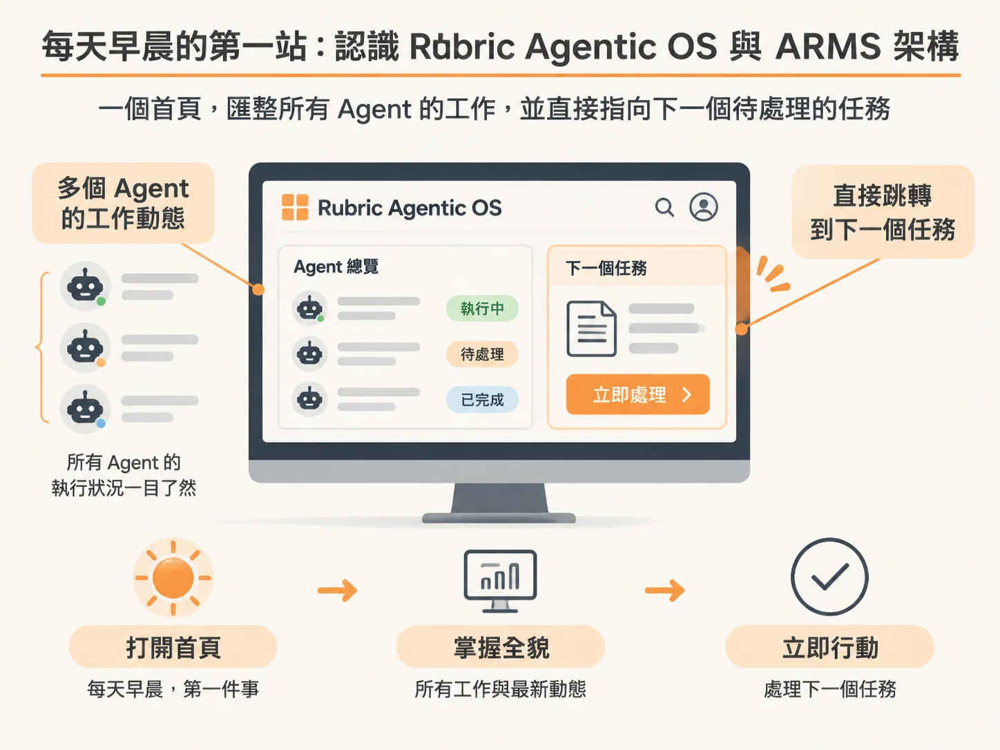
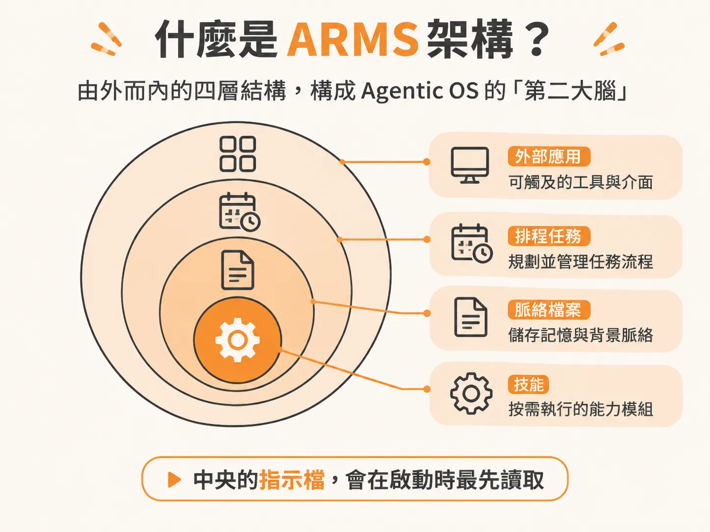

# 每天早晨的第一站：認識 Rubric Agentic OS 與 ARMS 架構

每天開始工作時，最容易讓人手忙腳亂的往往不是任務本身，而是不知道各個 AI Agent 昨晚做了什麼、目前進度停在哪裡，以及接下來該先處理哪件事。

Rubric Agentic OS 就是為了解決這個問題而設計的起點。它是整套配置的專屬首頁，每天早晨第一件事就是打開它。所有 Agent 正在執行的工作與最新動態，都會彙整在同一個螢幕畫面上，讓你能一眼掌握全貌，並直接跳轉到下一個需要你介入或處理的任務中。

除了作為每天的工作儀表板，這套系統更重要的價值在於背後的思考脈絡——ARMS 框架。理解這套框架，你就不只是照抄一套現成的設定，而是真正明白整體架構為什麼要長成這個模樣。

### 什麼是 ARMS 架構？

在 Agentic OS 的視覺呈現中，整個工作空間就像一顆由外向內分層的「第二大腦」，由四個關鍵層次構成，簡稱為 ARMS：

- **Applications（應用程式）**：最外層的藍色節點，代表 Agent 在這台電腦之外所能觸及的所有外部工具與服務。
- **Routines（常規排程）**：中間的金色節點，代表依照特定時間排程自動運行的例行任務。
- **Memory（記憶）**：依不同部門色彩標記的區塊，收納了所有提供脈絡的檔案，讓 Agent 在處理事務時有足夠的背景資訊。
- **Skills（技能）**：最內層的乳白色節點，是 Agent 可以隨時按需執行的具體能力。每個節點對應一項技能，命名方式就如同平常輸入指令時的形式（例如 `/name`）。

在這四層架構的正核心，放置的是 `AGENTS.md`。這是 Agent 啟動時最先讀取的指示檔案，負責定義全局的運作原則。

透過 ARMS 的分層邏輯，Agent 負責建立並維持這些內容的最新狀態。你既能掌握它對外連結的工具與自動排程，也能隨時檢視它調用的知識與具備的技能，讓整個自動化工作環境清晰且井然有序。
