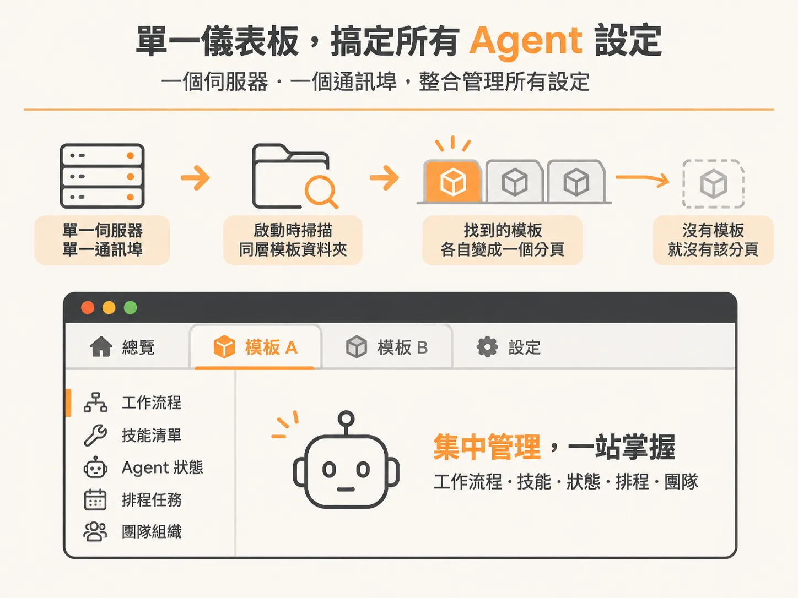

# 為什麼 Rubric Console 是微型應用的最佳著陸點？

在打造 AI Agent 或自動化工作流程時，開發者常會順手寫出許多微型應用（micro app）、狀態監控小工具或是團隊組織檢視頁面。這些零星的小專案通常各跑各的 port、散落在不同視窗與終端機裡，最後往往落得難以管理、甚至被遺忘的下場。

Rubric Console 就是為了給這些工具一個固定的家而設計的。

## 打造出來，就有地方安放

當你建立一個新的 micro app、整理好 agent 團隊資訊，或寫好輔助管理的小工具時，最怕花時間為每個小介面重新刻版面、配色彩。Rubric Console 直接解決了「工具做完該放哪裡」的問題。

它在出廠時就已經內建好了整套設計原則（design principles）。這代表任何你剛啟動的小工具，只要一放進 Console，就擁有一塊現成的著陸點（landing pad）。它在視覺與操作風格上完全融入系統，從啟動的第一分鐘起就看起來和諧得體。你只需要專注把核心功能蓋好，不必擔心零碎專案拼湊起來像東拼西湊的半成品——只要做出來，它就立刻有地方可以住。

## 單一儀表板搞定所有 Agent 設定

除了外觀一致，Console 在架構上也強調不切換視窗的整合體驗。它是一個集中式的控制中心，能同時掌握工作流程（workflows）、技能清單（skills）、agent 當前狀態、排程任務（crons）以及團隊組織架構。

背後的伺服器運作原則相當精簡：

- **單一伺服器、單一通訊埠**：整個控制台由單一 Node.js 伺服器啟動（預設通訊埠為 `5050`），不需要為各個分頁分別開 port。
- **自動偵測與路由合併**：啟動時，系統會自動掃描同層級的模板資料夾，自動合併對應的 API 路由，並在前端動態產生導覽列。你不需要手動把分頁一條一條接起來；移除某個模板資料夾，該分頁就會自動消失。
- **常駐預設分頁**：無論安裝了哪些客製模板，控制台都預設保留兩個分頁——介紹頁（Welcome），以及內建 50 個像素風格圖示的圖庫頁（Icons），方便你在設定檔中快速挑選合適的 agent 頭像。

透過內建的設計一致性與自動掛載機制，Console 讓所有微型應用從開發的第一步起，就擁有穩定且風格一致的著陸點。
