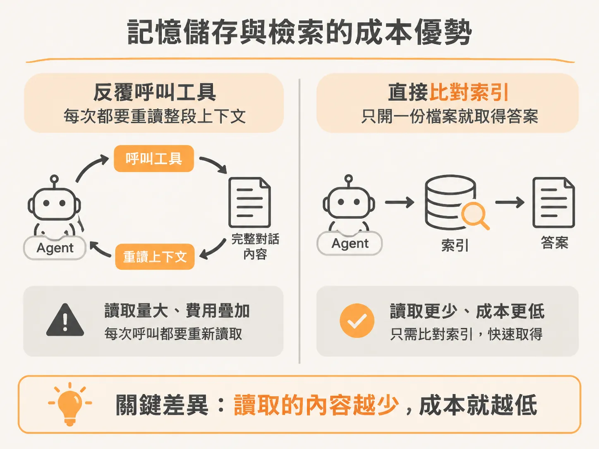

# Rubric Second Brain：可視化 Agent 記憶與零 Token 的底層架構

使用 AI agent 協助工作時，最常遇到的困擾就是記憶不透明：你很難確認 agent 到底記住了什麼，也不知道那些偏好與工作脈絡被寫進了哪份檔案。每次需要它回想歷史資訊，往往還要經歷多次工具往返，既浪費時間又耗費大量 token。

Rubric Second Brain 解決這個問題的方式，是把 agent 記住的所有內容直接視覺化。

### 將埋在檔案裡的記憶搬到眼前

過去 agent 的記憶通常散落在各個文字檔或設定檔裡。Rubric Second Brain 提供了一張動態地圖，把整個 agent 工作區攤在使用者面前。

這張地圖整合了工作區裡的所有檔案、技能（skills）、例行任務（routines）以及串接的應用程式。你可以像瀏覽地圖一樣看清整個架構，agent 對你與你工作的了解不再深埋在資料夾底層，而是清晰可見。你再也不必瞎猜系統到底儲存了哪些內容、存在哪個角落。

為了保持精準與輕量，這套視覺圖譜以檔案作為節點、Markdown 連結作為邊，每次載入時直接從硬碟重新建構。它刻意捨棄了需要呼叫語言模型提取實體的實體圖譜（entity graphs）與圖資料庫，避免每份文件都要額外花費 token 處理，也防止圖譜隨時間漂移失真。

### 記憶儲存與檢索的成本優勢

在視覺介面的底層，是一套專門設計的記憶儲存與檢索系統。它的核心目標只有兩個：調閱速度更快、運作成本更低。

一般 agent 在調閱記憶時，成本大致取決於「上下文長度 × 對話輪數（context × turns）」。一旦 agent 需要反覆呼叫工具查詢資料，每來回一次，模型就得重新讀取整段已經載入的對話上下文，費用與延遲隨之疊加。

Rubric 的底層引擎（`brain.js`）改變了這個流程：

* **檢索移至模型外部**：使用確定性演算法（deterministic retrieval）直接比對記憶索引與權重，只開啟得分最高的那份檔案，並擷取最符合問題的段落。
* **零 Token 成本**：單次檢索通常只需要讀取約 20KB 的資料、耗時約 5 毫秒，且完全不消耗任何語言模型的 token。
* **無模型儲存**：寫入與儲存記憶時完全不需要啟動模型，直接降低了維護記憶庫的日常開銷。

藉由將檢索與儲存移出模型本體，使用者既能在介面上隨時掌握 agent 的認知全貌，又能在實際調閱記憶時省下可觀的延遲與運算成本。
