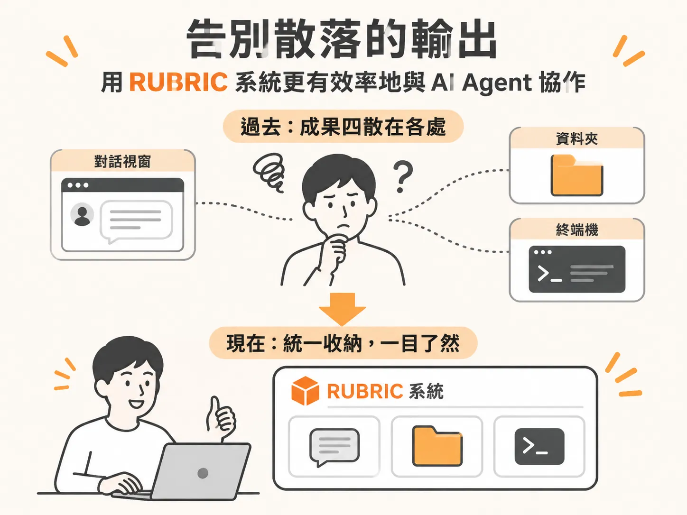

# 告別散落的輸出：用 RUBRIC 系統更有效率地與 AI Agent 協作

在與 AI Agent 協作時，你常會遇到一個尷尬的狀況：Agent 其實很擅長執行任務、把事情做完，但它們很不擅長向你展示過程與結果。

因為「會做事卻不會展示」，產出的內容最後往往四散在各處——有的留在對話視窗裡，有的藏在某個資料夾，有的則被淹沒在終端機（terminal）的文字輸出中。每當你想回頭確認剛剛究竟發生了什麼事，就得在不同視窗之間翻找。

RUBRIC 系統就是為了解決這個問題而生的一套工具組，旨在幫你更好地與 AI Agent 協作。它提供了一個清晰的架構，讓你能更快找到需要的資料、以更視覺化的方式掌握成果，進而全面提升運用 Agent 的生產力。

整套 RUBRIC 系統由三個部分組成。你可以根據自己的工作流程與需求，選擇一次採用全部工具，或是先挑選其中幾項來嘗試。
